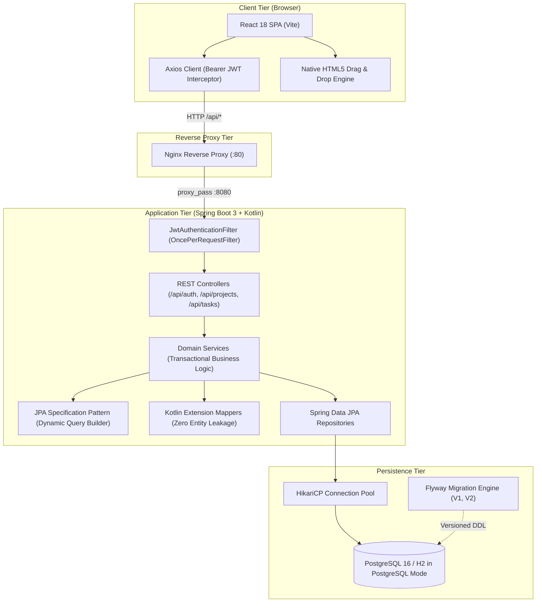
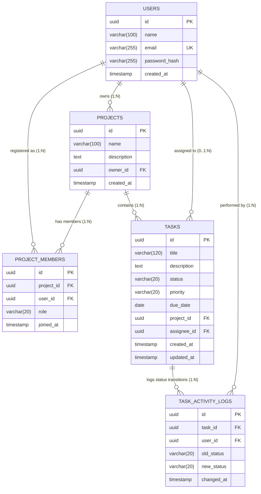

# MASTER AI REPRODUCTION BLUEPRINT: TaskFlow (Full-Stack Kanban Platform)

> **PROMPT FOR AI / LLM AGENT (ChatGPT / Claude / Antigravity)**:
> "You are an expert Principal Full-Stack Software Architect. Your task is to reconstruct the entire **TaskFlow** project from scratch. Follow the exact project structure, exact file names, exact dependency versions, exact database schemas, design patterns, function implementations, and interview technical details provided in this blueprint. Do not take shortcuts, do not use dummy placeholders, and adhere strictly to all architectural constraints defined below."

---

## 1. Executive Project Overview

* **Application Name**: TaskFlow
* **Domain**: Collaborative Multi-User Task & Project Management (Kanban Board)
* **Backend Stack**: Spring Boot 3.4.3, Kotlin 2.3.21, Java 21 LTS, Spring Security (Stateless JJWT 0.12.6), Spring Data JPA, Flyway 10, Maven, MockK 1.13, SpringMockK 4.0
* **Frontend Stack**: React 18.3, TypeScript 5.5/5.7, Vite 6, Tailwind CSS 3.4, Lucide React, Vitest 3.0, React Testing Library
* **Databases**: PostgreSQL 16 (Production/Docker), In-Memory H2 in PostgreSQL Mode (Local Development)
* **Containerization**: Docker, Docker Compose, Multi-Stage Builds, Nginx Alpine Reverse Proxy

---

## 2. High-Level Architecture & Entity Relationships

### 2.1 System Architecture



### 2.2 Relational Entity-Relationship (ER) Diagram



---

## 3. Complete Directory & File Structure

```
task-flow/
├── .gitignore
├── docker-compose.yml
├── README.md
├── TASKFLOW_AI_BLUEPRINT.md
├── backend/
│   ├── pom.xml
│   ├── Dockerfile
│   └── src/
│       ├── main/
│       │   ├── kotlin/com/taskflow/
│       │   │   ├── TaskflowBackendApplication.kt
│       │   │   ├── config/
│       │   │   │   ├── DataInitializer.kt
│       │   │   │   └── OpenApiConfig.kt
│       │   │   ├── controller/
│       │   │   │   ├── AuthController.kt
│       │   │   │   ├── ProjectController.kt
│       │   │   │   ├── TaskController.kt
│       │   │   │   └── AiController.kt
│       │   │   ├── domain/
│       │   │   │   ├── model/
│       │   │   │   │   ├── User.kt
│       │   │   │   │   ├── Project.kt
│       │   │   │   │   ├── ProjectMember.kt
│       │   │   │   │   ├── ProjectRole.kt
│       │   │   │   │   ├── Task.kt
│       │   │   │   │   ├── TaskPriority.kt
│       │   │   │   │   ├── TaskStatus.kt
│       │   │   │   │   └── TaskActivityLog.kt
│       │   │   │   ├── repository/
│       │   │   │   │   ├── UserRepository.kt
│       │   │   │   │   ├── ProjectRepository.kt
│       │   │   │   │   ├── ProjectMemberRepository.kt
│       │   │   │   │   ├── TaskRepository.kt
│       │   │   │   │   └── TaskActivityLogRepository.kt
│       │   │   │   └── specification/
│       │   │   │       └── TaskSpecification.kt
│       │   │   ├── dto/
│       │   │   │   ├── request/
│       │   │   │   │   ├── LoginRequest.kt
│       │   │   │   │   ├── RegisterRequest.kt
│       │   │   │   │   ├── CreateProjectRequest.kt
│       │   │   │   │   ├── AddProjectMemberRequest.kt
│       │   │   │   │   ├── CreateTaskRequest.kt
│       │   │   │   │   ├── BatchCreateTasksRequest.kt
│       │   │   │   │   ├── AiGeneratePlanRequest.kt
│       │   │   │   │   ├── UpdateTaskRequest.kt
│       │   │   │   │   └── UpdateTaskStatusRequest.kt
│       │   │   │   └── response/
│       │   │   │       ├── AuthResponse.kt
│       │   │   │       ├── UserResponse.kt
│       │   │   │       ├── ProjectResponse.kt
│       │   │   │       ├── ProjectMemberResponse.kt
│       │   │   │       ├── ProjectSummaryResponse.kt
│       │   │   │       ├── TaskResponse.kt
│       │   │   │       ├── AiPlanResponse.kt
│       │   │   │       ├── PageResponse.kt
│       │   │   │       └── ErrorResponse.kt
│       │   │   ├── exception/
│       │   │   │   ├── Exceptions.kt
│       │   │   │   └── GlobalExceptionHandler.kt
│       │   │   ├── mapper/
│       │   │   │   └── EntityMappers.kt
│       │   │   ├── security/
│       │   │   │   ├── SecurityConfig.kt
│       │   │   │   ├── UserPrincipal.kt
│       │   │   │   ├── CustomUserDetailsService.kt
│       │   │   │   ├── JwtService.kt
│       │   │   │   └── JwtAuthenticationFilter.kt
│       │   │   └── service/
│       │   │       ├── AuthService.kt
│       │   │       ├── ProjectService.kt
│       │   │       ├── TaskService.kt
│       │   │       └── AiPlanningService.kt
│       │   └── resources/
│       │       ├── application.yml
│       │       └── db/migration/
│       │           ├── V1__init_schema.sql
│       │           └── V2__add_project_members.sql
│       └── test/kotlin/com/taskflow/
│           ├── TaskflowBackendApplicationTests.kt
│           └── service/
│               ├── AuthServiceTest.kt
│               ├── ProjectServiceTest.kt
│               └── TaskServiceTest.kt
└── frontend/
    ├── package.json
    ├── tsconfig.json
    ├── vite.config.ts
    ├── tailwind.config.js
    ├── postcss.config.js
    ├── index.html
    ├── nginx.conf
    ├── Dockerfile
    └── src/
        ├── index.css
        ├── main.tsx
        ├── App.tsx
        ├── types/
        │   └── index.ts
        ├── api/
        │   └── client.ts
        ├── context/
        │   └── AuthContext.tsx
        ├── components/
        │   ├── common/
        │   │   ├── Button.tsx
        │   │   ├── Badge.tsx
        │   │   └── Modal.tsx
        │   └── board/
        │       ├── TaskCard.tsx
        │       ├── KanbanColumn.tsx
        │       ├── SummaryBar.tsx
        │       ├── TaskModal.tsx
        │       ├── ProjectModal.tsx
        │       ├── MembersModal.tsx
        │       └── AiPlannerModal.tsx
        ├── pages/
        │   ├── AuthPage.tsx
        │   └── BoardPage.tsx
        └── test/
            ├── setup.ts
            ├── SummaryBar.test.tsx
            ├── TaskCard.test.tsx
            └── AiPlannerModal.test.tsx
```

---

## 4. Orchestration, Build & Configuration Files

### 4.1 `docker-compose.yml`
```yaml
version: '3.8'

services:
  postgres:
    image: postgres:16-alpine
    container_name: taskflow-postgres
    restart: always
    environment:
      POSTGRES_DB: taskflow
      POSTGRES_USER: taskflow
      POSTGRES_PASSWORD: taskflow_password
    ports:
      - "5432:5432"
    volumes:
      - pgdata:/var/lib/postgresql/data
    healthcheck:
      test: ["CMD-SHELL", "pg_isready -U taskflow -d taskflow"]
      interval: 5s
      timeout: 5s
      retries: 5

  backend:
    build:
      context: ./backend
      dockerfile: Dockerfile
    container_name: taskflow-backend
    restart: always
    depends_on:
      postgres:
        condition: service_healthy
    environment:
      PORT: 8080
      SPRING_PROFILES_ACTIVE: prod
      DB_URL: jdbc:postgresql://postgres:5432/taskflow
      DB_USERNAME: taskflow
      DB_PASSWORD: taskflow_password
      JWT_SECRET: 404E635266556A586E3272357538782F413F4428472B4B6250645367566B5970
      CORS_ALLOWED_ORIGINS: http://localhost,http://localhost:80,http://localhost:5173
    ports:
      - "8080:8080"

  frontend:
    build:
      context: ./frontend
      dockerfile: Dockerfile
    container_name: taskflow-frontend
    restart: always
    depends_on:
      - backend
    ports:
      - "80:80"

volumes:
  pgdata:
```

### 4.2 `backend/Dockerfile`
```dockerfile
# Stage 1: Build JAR using Maven
FROM maven:3.9.9-eclipse-temurin-21-alpine AS builder
WORKDIR /app
COPY pom.xml .
RUN mvn dependency:go-offline -B
COPY src ./src
RUN mvn clean package -DskipTests

# Stage 2: Minimal Distroless/JRE runtime
FROM eclipse-temurin:21-jre-alpine
WORKDIR /app
RUN addgroup -S appgroup && adduser -S appuser -G appgroup
USER appuser
COPY --from=builder /app/target/taskflow-backend-0.0.1-SNAPSHOT.jar app.jar
EXPOSE 8080
ENTRYPOINT ["java", "-jar", "app.jar"]
```

### 4.3 `frontend/Dockerfile` & `frontend/nginx.conf`

#### `frontend/Dockerfile`
```dockerfile
# Stage 1: Build Vite static assets
FROM node:20-alpine AS builder
WORKDIR /app
COPY package*.json ./
RUN npm ci
COPY . .
RUN npm run build

# Stage 2: Nginx Web Server & Reverse Proxy
FROM nginx:alpine
COPY --from=builder /app/dist /usr/share/nginx/html
COPY nginx.conf /etc/nginx/conf.d/default.conf
EXPOSE 80
CMD ["nginx", "-g", "daemon off;"]
```

#### `frontend/nginx.conf`
```nginx
server {
    listen 80;
    server_name localhost;

    # Static React assets
    location / {
        root /usr/share/nginx/html;
        index index.html index.htm;
        try_files $uri $uri/ /index.html;
    }

    # Reverse proxy backend API to avoid CORS issues
    location /api/ {
        proxy_pass http://backend:8080/api/;
        proxy_set_header Host $host;
        proxy_set_header X-Real-IP $remote_addr;
        proxy_set_header X-Forwarded-For $proxy_add_x_forwarded_for;
        proxy_set_header X-Forwarded-Proto $scheme;
    }
}
```

### 4.4 `backend/pom.xml`
```xml
<?xml version="1.0" encoding="UTF-8"?>
<project xmlns="http://maven.apache.org/POM/4.0.0" xmlns:xsi="http://www.w3.org/2001/XMLSchema-instance"
	xsi:schemaLocation="http://maven.apache.org/POM/4.0.0 https://maven.apache.org/xsd/maven-4.0.0.xsd">
	<modelVersion>4.0.0</modelVersion>
	<parent>
		<groupId>org.springframework.boot</groupId>
		<artifactId>spring-boot-starter-parent</artifactId>
		<version>3.4.3</version>
		<relativePath/>
	</parent>
	<groupId>com.taskflow</groupId>
	<artifactId>taskflow-backend</artifactId>
	<version>0.0.1-SNAPSHOT</version>
	<name>taskflow-backend</name>
	<description>TaskFlow REST API Backend</description>

	<properties>
		<java.version>21</java.version>
		<kotlin.version>2.3.21</kotlin.version>
		<jjwt.version>0.12.6</jjwt.version>
		<springdoc.version>2.8.5</springdoc.version>
		<mockk.version>1.13.13</mockk.version>
		<springmockk.version>4.0.2</springmockk.version>
	</properties>

	<dependencies>
		<!-- Spring Boot Starters -->
		<dependency>
			<groupId>org.springframework.boot</groupId>
			<artifactId>spring-boot-starter-web</artifactId>
		</dependency>
		<dependency>
			<groupId>org.springframework.boot</groupId>
			<artifactId>spring-boot-starter-data-jpa</artifactId>
		</dependency>
		<dependency>
			<groupId>org.springframework.boot</groupId>
			<artifactId>spring-boot-starter-security</artifactId>
		</dependency>
		<dependency>
			<groupId>org.springframework.boot</groupId>
			<artifactId>spring-boot-starter-validation</artifactId>
		</dependency>

		<!-- Flyway Database Migrations -->
		<dependency>
			<groupId>org.flywaydb</groupId>
			<artifactId>flyway-core</artifactId>
		</dependency>
		<dependency>
			<groupId>org.flywaydb</groupId>
			<artifactId>flyway-database-postgresql</artifactId>
		</dependency>

		<!-- Kotlin support -->
		<dependency>
			<groupId>org.jetbrains.kotlin</groupId>
			<artifactId>kotlin-reflect</artifactId>
		</dependency>
		<dependency>
			<groupId>org.jetbrains.kotlin</groupId>
			<artifactId>kotlin-stdlib</artifactId>
		</dependency>
		<dependency>
			<groupId>com.fasterxml.jackson.module</groupId>
			<artifactId>jackson-module-kotlin</artifactId>
		</dependency>

		<!-- JJWT for Stateless JWT Security -->
		<dependency>
			<groupId>io.jsonwebtoken</groupId>
			<artifactId>jjwt-api</artifactId>
			<version>${jjwt.version}</version>
		</dependency>
		<dependency>
			<groupId>io.jsonwebtoken</groupId>
			<artifactId>jjwt-impl</artifactId>
			<version>${jjwt.version}</version>
			<scope>runtime</scope>
		</dependency>
		<dependency>
			<groupId>io.jsonwebtoken</groupId>
			<artifactId>jjwt-jackson</artifactId>
			<version>${jjwt.version}</version>
			<scope>runtime</scope>
		</dependency>

		<!-- OpenAPI / Swagger 3 UI -->
		<dependency>
			<groupId>org.springdoc</groupId>
			<artifactId>springdoc-openapi-starter-webmvc-ui</artifactId>
			<version>${springdoc.version}</version>
		</dependency>

		<!-- Databases -->
		<dependency>
			<groupId>com.h2database</groupId>
			<artifactId>h2</artifactId>
			<scope>runtime</scope>
		</dependency>
		<dependency>
			<groupId>org.postgresql</groupId>
			<artifactId>postgresql</artifactId>
			<scope>runtime</scope>
		</dependency>

		<!-- Testing Dependencies -->
		<dependency>
			<groupId>org.springframework.boot</groupId>
			<artifactId>spring-boot-starter-test</artifactId>
			<scope>test</scope>
		</dependency>
		<dependency>
			<groupId>org.springframework.security</groupId>
			<artifactId>spring-security-test</artifactId>
			<scope>test</scope>
		</dependency>
		<dependency>
			<groupId>io.mockk</groupId>
			<artifactId>mockk-jvm</artifactId>
			<version>${mockk.version}</version>
			<scope>test</scope>
		</dependency>
		<dependency>
			<groupId>com.ninja-squad</groupId>
			<artifactId>springmockk</artifactId>
			<version>${springmockk.version}</version>
			<scope>test</scope>
		</dependency>
		<dependency>
			<groupId>org.jetbrains.kotlin</groupId>
			<artifactId>kotlin-test-junit5</artifactId>
			<scope>test</scope>
		</dependency>
	</dependencies>

	<build>
		<sourceDirectory>${project.basedir}/src/main/kotlin</sourceDirectory>
		<testSourceDirectory>${project.basedir}/src/test/kotlin</testSourceDirectory>
		<plugins>
			<plugin>
				<groupId>org.springframework.boot</groupId>
				<artifactId>spring-boot-maven-plugin</artifactId>
			</plugin>
			<plugin>
				<groupId>org.jetbrains.kotlin</groupId>
				<artifactId>kotlin-maven-plugin</artifactId>
				<configuration>
					<args>
						<arg>-Xjsr305=strict</arg>
					</args>
					<compilerPlugins>
						<plugin>spring</plugin>
						<plugin>jpa</plugin>
					</compilerPlugins>
				</configuration>
				<dependencies>
					<dependency>
						<groupId>org.jetbrains.kotlin</groupId>
						<artifactId>kotlin-maven-allopen</artifactId>
						<version>${kotlin.version}</version>
					</dependency>
					<dependency>
						<groupId>org.jetbrains.kotlin</groupId>
						<artifactId>kotlin-maven-noarg</artifactId>
						<version>${kotlin.version}</version>
					</dependency>
				</dependencies>
			</plugin>
		</plugins>
	</build>
</project>
```

### 4.5 `backend/src/main/resources/application.yml`
```yaml
server:
  port: ${PORT:8088}

spring:
  application:
    name: taskflow-backend
  profiles:
    active: dev

---
spring:
  config:
    activate:
      on-profile: dev
  datasource:
    url: jdbc:h2:mem:taskflowdb;MODE=PostgreSQL;DATABASE_TO_LOWER=TRUE;DEFAULT_NULL_ORDERING=HIGH
    driver-class-name: org.h2.Driver
    username: sa
    password: 
  jpa:
    hibernate:
      ddl-auto: validate
    show-sql: false
    properties:
      hibernate:
        format_sql: true
        default_batch_fetch_size: 50
  h2:
    console:
      enabled: true
      path: /h2-console
  flyway:
    enabled: true
    locations: classpath:db/migration

---
spring:
  config:
    activate:
      on-profile: prod
  datasource:
    url: ${DB_URL:jdbc:postgresql://localhost:5432/taskflow}
    username: ${DB_USERNAME:taskflow}
    password: ${DB_PASSWORD:taskflow}
    driver-class-name: org.postgresql.Driver
  jpa:
    hibernate:
      ddl-auto: validate
    show-sql: false
    properties:
      hibernate:
        default_batch_fetch_size: 50
  flyway:
    enabled: true
    locations: classpath:db/migration

---
security:
  jwt:
    secret: ${JWT_SECRET:404E635266556A586E3272357538782F413F4428472B4B6250645367566B5970}
    expiration-ms: ${JWT_EXPIRATION_MS:86400000}

cors:
  allowed-origins: ${CORS_ALLOWED_ORIGINS:http://localhost:5173,http://localhost:3000}

springdoc:
  swagger-ui:
    path: /swagger-ui.html
    operations-sorter: method
  api-docs:
    path: /v3/api-docs
```

### 4.6 `frontend/package.json` & `frontend/vite.config.ts`

#### `frontend/package.json`
```json
{
  "name": "taskflow-frontend",
  "private": true,
  "version": "1.0.0",
  "type": "module",
  "scripts": {
    "dev": "vite",
    "build": "tsc && vite build",
    "preview": "vite preview",
    "test": "vitest run"
  },
  "dependencies": {
    "axios": "^1.7.9",
    "lucide-react": "^0.475.0",
    "react": "^18.3.1",
    "react-dom": "^18.3.1"
  },
  "devDependencies": {
    "@testing-library/jest-dom": "^6.6.3",
    "@testing-library/react": "^16.2.0",
    "@types/node": "^22.13.4",
    "@types/react": "^18.3.18",
    "@types/react-dom": "^18.3.5",
    "@vitejs/plugin-react": "^4.3.4",
    "autoprefixer": "^10.4.20",
    "jsdom": "^26.0.0",
    "postcss": "^8.5.2",
    "tailwindcss": "^3.4.17",
    "typescript": "^5.7.3",
    "vite": "^6.1.0",
    "vitest": "^3.0.5"
  }
}
```

#### `frontend/vite.config.ts`
```typescript
import { defineConfig } from 'vite';
import react from '@vitejs/plugin-react';

export default defineConfig({
  plugins: [react()],
  server: {
    port: 5173,
    proxy: {
      '/api': {
        target: 'http://localhost:8088',
        changeOrigin: true,
      },
    },
  },
  test: {
    globals: true,
    environment: 'jsdom',
    setupFiles: './src/test/setup.ts',
  },
});
```

---

## 5. Database Migrations (Flyway SQL Engine)

### `backend/src/main/resources/db/migration/V1__init_schema.sql`
```sql
CREATE TABLE IF NOT EXISTS users (
    id UUID PRIMARY KEY,
    name VARCHAR(100) NOT NULL,
    email VARCHAR(255) NOT NULL UNIQUE,
    password_hash VARCHAR(255) NOT NULL,
    created_at TIMESTAMP WITH TIME ZONE NOT NULL DEFAULT CURRENT_TIMESTAMP
);

CREATE TABLE IF NOT EXISTS projects (
    id UUID PRIMARY KEY,
    name VARCHAR(100) NOT NULL,
    description TEXT,
    owner_id UUID NOT NULL,
    created_at TIMESTAMP WITH TIME ZONE NOT NULL DEFAULT CURRENT_TIMESTAMP,
    CONSTRAINT fk_projects_owner FOREIGN KEY (owner_id) REFERENCES users (id) ON DELETE CASCADE
);

CREATE TABLE IF NOT EXISTS tasks (
    id UUID PRIMARY KEY,
    title VARCHAR(120) NOT NULL,
    description TEXT,
    status VARCHAR(20) NOT NULL DEFAULT 'TODO',
    priority VARCHAR(20) NOT NULL DEFAULT 'MEDIUM',
    due_date DATE,
    project_id UUID NOT NULL,
    assignee_id UUID,
    created_at TIMESTAMP WITH TIME ZONE NOT NULL DEFAULT CURRENT_TIMESTAMP,
    updated_at TIMESTAMP WITH TIME ZONE NOT NULL DEFAULT CURRENT_TIMESTAMP,
    CONSTRAINT fk_tasks_project FOREIGN KEY (project_id) REFERENCES projects (id) ON DELETE CASCADE,
    CONSTRAINT fk_tasks_assignee FOREIGN KEY (assignee_id) REFERENCES users (id) ON DELETE SET NULL
);

CREATE TABLE IF NOT EXISTS task_activity_logs (
    id UUID PRIMARY KEY,
    task_id UUID NOT NULL,
    user_id UUID NOT NULL,
    old_status VARCHAR(20) NOT NULL,
    new_status VARCHAR(20) NOT NULL,
    changed_at TIMESTAMP WITH TIME ZONE NOT NULL DEFAULT CURRENT_TIMESTAMP,
    CONSTRAINT fk_activity_task FOREIGN KEY (task_id) REFERENCES tasks (id) ON DELETE CASCADE,
    CONSTRAINT fk_activity_user FOREIGN KEY (user_id) REFERENCES users (id) ON DELETE CASCADE
);

CREATE INDEX IF NOT EXISTS idx_projects_owner ON projects(owner_id);
CREATE INDEX IF NOT EXISTS idx_tasks_project ON tasks(project_id);
CREATE INDEX IF NOT EXISTS idx_tasks_status ON tasks(status);
CREATE INDEX IF NOT EXISTS idx_tasks_assignee ON tasks(assignee_id);
CREATE INDEX IF NOT EXISTS idx_tasks_due_date ON tasks(due_date);
```

### `backend/src/main/resources/db/migration/V2__add_project_members.sql`
```sql
CREATE TABLE IF NOT EXISTS project_members (
    id UUID PRIMARY KEY,
    project_id UUID NOT NULL,
    user_id UUID NOT NULL,
    role VARCHAR(20) NOT NULL DEFAULT 'MEMBER',
    joined_at TIMESTAMP WITH TIME ZONE NOT NULL DEFAULT CURRENT_TIMESTAMP,
    CONSTRAINT fk_project_members_project FOREIGN KEY (project_id) REFERENCES projects (id) ON DELETE CASCADE,
    CONSTRAINT fk_project_members_user FOREIGN KEY (user_id) REFERENCES users (id) ON DELETE CASCADE,
    CONSTRAINT uq_project_member UNIQUE (project_id, user_id)
);

CREATE INDEX IF NOT EXISTS idx_project_members_project ON project_members(project_id);
CREATE INDEX IF NOT EXISTS idx_project_members_user ON project_members(user_id);
```

---

## 6. Complete Backend Source Code & Implementation Details

### 6.1 Domain Models & Enums

#### `ProjectRole.kt`
```kotlin
package com.taskflow.domain.model

enum class ProjectRole {
    OWNER,
    MEMBER
}
```

#### `TaskPriority.kt`
```kotlin
package com.taskflow.domain.model

enum class TaskPriority {
    LOW,
    MEDIUM,
    HIGH
}
```

#### `TaskStatus.kt`
```kotlin
package com.taskflow.domain.model

enum class TaskStatus {
    TODO,
    IN_PROGRESS,
    DONE
}
```

#### `User.kt`
```kotlin
package com.taskflow.domain.model

import jakarta.persistence.*
import java.time.Instant
import java.util.UUID

@Entity
@Table(name = "users")
data class User(
    @Id
    @GeneratedValue(strategy = GenerationType.UUID)
    val id: UUID? = null,

    @Column(nullable = false, length = 100)
    var name: String,

    @Column(nullable = false, unique = true, length = 255)
    var email: String,

    @Column(name = "password_hash", nullable = false, length = 255)
    var passwordHash: String,

    @Column(name = "created_at", nullable = false, updatable = false)
    val createdAt: Instant = Instant.now()
)
```

#### `Project.kt`
```kotlin
package com.taskflow.domain.model

import jakarta.persistence.*
import java.time.Instant
import java.util.UUID

@Entity
@Table(name = "projects")
data class Project(
    @Id
    @GeneratedValue(strategy = GenerationType.UUID)
    val id: UUID? = null,

    @Column(nullable = false, length = 100)
    var name: String,

    @Column(columnDefinition = "TEXT")
    var description: String? = null,

    @ManyToOne(fetch = FetchType.LAZY)
    @JoinColumn(name = "owner_id", nullable = false)
    var owner: User,

    @Column(name = "created_at", nullable = false, updatable = false)
    val createdAt: Instant = Instant.now()
)
```

#### `ProjectMember.kt`
```kotlin
package com.taskflow.domain.model

import jakarta.persistence.*
import java.time.Instant
import java.util.UUID

@Entity
@Table(name = "project_members")
data class ProjectMember(
    @Id
    @GeneratedValue(strategy = GenerationType.UUID)
    val id: UUID? = null,

    @ManyToOne(fetch = FetchType.LAZY)
    @JoinColumn(name = "project_id", nullable = false)
    val project: Project,

    @ManyToOne(fetch = FetchType.LAZY)
    @JoinColumn(name = "user_id", nullable = false)
    val user: User,

    @Enumerated(EnumType.STRING)
    @Column(nullable = false, length = 20)
    var role: ProjectRole = ProjectRole.MEMBER,

    @Column(name = "joined_at", nullable = false, updatable = false)
    val joinedAt: Instant = Instant.now()
)
```

#### `Task.kt`
```kotlin
package com.taskflow.domain.model

import jakarta.persistence.*
import java.time.Instant
import java.time.LocalDate
import java.util.UUID

@Entity
@Table(name = "tasks")
data class Task(
    @Id
    @GeneratedValue(strategy = GenerationType.UUID)
    val id: UUID? = null,

    @Column(nullable = false, length = 120)
    var title: String,

    @Column(columnDefinition = "TEXT")
    var description: String? = null,

    @Enumerated(EnumType.STRING)
    @Column(nullable = false, length = 20)
    var status: TaskStatus = TaskStatus.TODO,

    @Enumerated(EnumType.STRING)
    @Column(nullable = false, length = 20)
    var priority: TaskPriority = TaskPriority.MEDIUM,

    @Column(name = "due_date")
    var dueDate: LocalDate? = null,

    @ManyToOne(fetch = FetchType.LAZY)
    @JoinColumn(name = "project_id", nullable = false)
    val project: Project,

    @ManyToOne(fetch = FetchType.LAZY)
    @JoinColumn(name = "assignee_id")
    var assignee: User? = null,

    @Column(name = "created_at", nullable = false, updatable = false)
    val createdAt: Instant = Instant.now(),

    @Column(name = "updated_at", nullable = false)
    var updatedAt: Instant = Instant.now()
) {
    @PreUpdate
    fun onUpdate() {
        updatedAt = Instant.now()
    }
}
```

#### `TaskActivityLog.kt`
```kotlin
package com.taskflow.domain.model

import jakarta.persistence.*
import java.time.Instant
import java.util.UUID

@Entity
@Table(name = "task_activity_logs")
data class TaskActivityLog(
    @Id
    @GeneratedValue(strategy = GenerationType.UUID)
    val id: UUID? = null,

    @ManyToOne(fetch = FetchType.LAZY)
    @JoinColumn(name = "task_id", nullable = false)
    val task: Task,

    @ManyToOne(fetch = FetchType.LAZY)
    @JoinColumn(name = "user_id", nullable = false)
    val user: User,

    @Enumerated(EnumType.STRING)
    @Column(name = "old_status", nullable = false, length = 20)
    val oldStatus: TaskStatus,

    @Enumerated(EnumType.STRING)
    @Column(name = "new_status", nullable = false, length = 20)
    val newStatus: TaskStatus,

    @Column(name = "changed_at", nullable = false, updatable = false)
    val changedAt: Instant = Instant.now()
)
```

---

### 6.2 Repositories

#### `UserRepository.kt`
```kotlin
package com.taskflow.domain.repository

import com.taskflow.domain.model.User
import org.springframework.data.jpa.repository.JpaRepository
import org.springframework.stereotype.Repository
import java.util.Optional
import java.util.UUID

@Repository
interface UserRepository : JpaRepository<User, UUID> {
    fun findByEmail(email: String): Optional<User>
    fun existsByEmail(email: String): Boolean
}
```

#### `ProjectRepository.kt`
```kotlin
package com.taskflow.domain.repository

import com.taskflow.domain.model.Project
import org.springframework.data.jpa.repository.JpaRepository
import org.springframework.data.jpa.repository.Query
import org.springframework.data.repository.query.Param
import org.springframework.stereotype.Repository
import java.util.UUID

@Repository
interface ProjectRepository : JpaRepository<Project, UUID> {
    fun findByOwnerId(ownerId: UUID): List<Project>

    @Query("""
        SELECT DISTINCT p FROM Project p 
        LEFT JOIN ProjectMember pm ON pm.project.id = p.id 
        WHERE p.owner.id = :userId OR pm.user.id = :userId
        ORDER BY p.createdAt DESC
    """)
    fun findAllByOwnerOrMember(@Param("userId") userId: UUID): List<Project>
}
```

#### `ProjectMemberRepository.kt`
```kotlin
package com.taskflow.domain.repository

import com.taskflow.domain.model.ProjectMember
import org.springframework.data.jpa.repository.JpaRepository
import org.springframework.data.jpa.repository.Query
import org.springframework.data.repository.query.Param
import org.springframework.stereotype.Repository
import java.util.Optional
import java.util.UUID

@Repository
interface ProjectMemberRepository : JpaRepository<ProjectMember, UUID> {
    fun findByProjectId(projectId: UUID): List<ProjectMember>

    @Query("SELECT pm FROM ProjectMember pm JOIN FETCH pm.user WHERE pm.project.id = :projectId ORDER BY pm.joinedAt ASC")
    fun findByProjectIdWithUser(@Param("projectId") projectId: UUID): List<ProjectMember>

    fun findByProjectIdAndUserId(projectId: UUID, userId: UUID): Optional<ProjectMember>
    fun existsByProjectIdAndUserId(projectId: UUID, userId: UUID): Boolean
    fun deleteByProjectIdAndUserId(projectId: UUID, userId: UUID)
}
```

#### `TaskRepository.kt`
```kotlin
package com.taskflow.domain.repository

import com.taskflow.domain.model.Task
import com.taskflow.domain.model.TaskStatus
import org.springframework.data.jpa.repository.JpaRepository
import org.springframework.data.jpa.repository.JpaSpecificationExecutor
import org.springframework.stereotype.Repository
import java.time.LocalDate
import java.util.UUID

@Repository
interface TaskRepository : JpaRepository<Task, UUID>, JpaSpecificationExecutor<Task> {
    fun countByProjectId(projectId: UUID): Long
    fun countByProjectIdAndStatus(projectId: UUID, status: TaskStatus): Long
    fun countByProjectIdAndDueDateBeforeAndStatusNot(projectId: UUID, date: LocalDate, status: TaskStatus): Long
}
```

#### `TaskActivityLogRepository.kt`
```kotlin
package com.taskflow.domain.repository

import com.taskflow.domain.model.TaskActivityLog
import org.springframework.data.jpa.repository.JpaRepository
import org.springframework.stereotype.Repository
import java.util.UUID

@Repository
interface TaskActivityLogRepository : JpaRepository<TaskActivityLog, UUID> {
    fun findByTaskIdOrderByChangedAtDesc(taskId: UUID): List<TaskActivityLog>
}
```

---

### 6.3 Specification Strategy Pattern (`TaskSpecification.kt`)

```kotlin
package com.taskflow.domain.specification

import com.taskflow.domain.model.Task
import com.taskflow.domain.model.TaskPriority
import com.taskflow.domain.model.TaskStatus
import org.springframework.data.jpa.domain.Specification
import java.util.UUID

object TaskSpecification {

    fun hasProject(projectId: UUID): Specification<Task> = Specification { root, _, cb ->
        cb.equal(root.get<Any>("project").get<UUID>("id"), projectId)
    }

    fun hasStatus(status: TaskStatus?): Specification<Task> = Specification { root, _, cb ->
        status?.let { cb.equal(root.get<TaskStatus>("status"), it) }
    }

    fun hasPriority(priority: TaskPriority?): Specification<Task> = Specification { root, _, cb ->
        priority?.let { cb.equal(root.get<TaskPriority>("priority"), it) }
    }

    fun hasAssignee(assigneeId: UUID?): Specification<Task> = Specification { root, _, cb ->
        assigneeId?.let { cb.equal(root.get<Any>("assignee").get<UUID>("id"), it) }
    }

    fun build(
        projectId: UUID,
        status: TaskStatus? = null,
        priority: TaskPriority? = null,
        assigneeId: UUID? = null
    ): Specification<Task> {
        return Specification.where(hasProject(projectId))
            .and(hasStatus(status))
            .and(hasPriority(priority))
            .and(hasAssignee(assigneeId))
    }
}
```

---

### 6.4 DTOs (Requests & Responses)

#### `Requests.kt`
```kotlin
package com.taskflow.dto.request

import com.taskflow.domain.model.TaskPriority
import com.taskflow.domain.model.TaskStatus
import jakarta.validation.constraints.Email
import jakarta.validation.constraints.NotBlank
import jakarta.validation.constraints.NotNull
import jakarta.validation.constraints.Size
import java.time.LocalDate
import java.util.UUID

data class LoginRequest(
    @field:NotBlank(message = "Email is required")
    @field:Email(message = "Email must be valid")
    val email: String,

    @field:NotBlank(message = "Password is required")
    val password: String
)

data class RegisterRequest(
    @field:NotBlank(message = "Name is required")
    @field:Size(min = 2, max = 100, message = "Name must be between 2 and 100 characters")
    val name: String,

    @field:NotBlank(message = "Email is required")
    @field:Email(message = "Email must be valid")
    val email: String,

    @field:NotBlank(message = "Password is required")
    @field:Size(min = 8, message = "Password must be at least 8 characters")
    val password: String
)

data class CreateProjectRequest(
    @field:NotBlank(message = "Project name is required")
    @field:Size(max = 100, message = "Project name cannot exceed 100 characters")
    val name: String,

    val description: String? = null
)

data class AddProjectMemberRequest(
    @field:NotBlank(message = "Email is required")
    @field:Email(message = "Email must be valid")
    val email: String
)

data class CreateTaskRequest(
    @field:NotBlank(message = "Title is required")
    @field:Size(max = 120, message = "Title cannot exceed 120 characters")
    val title: String,

    val description: String? = null,

    val status: TaskStatus = TaskStatus.TODO,

    val priority: TaskPriority = TaskPriority.MEDIUM,

    val dueDate: LocalDate? = null,

    val assigneeId: UUID? = null
)

data class UpdateTaskRequest(
    @field:NotBlank(message = "Title is required")
    @field:Size(max = 120, message = "Title cannot exceed 120 characters")
    val title: String,

    val description: String? = null,

    @field:NotNull(message = "Status is required")
    val status: TaskStatus,

    @field:NotNull(message = "Priority is required")
    val priority: TaskPriority,

    val dueDate: LocalDate? = null,

    val assigneeId: UUID? = null
)

data class UpdateTaskStatusRequest(
    @field:NotNull(message = "Status is required")
    val status: TaskStatus
)
```

#### `Responses.kt`
```kotlin
package com.taskflow.dto.response

import com.taskflow.domain.model.ProjectRole
import com.taskflow.domain.model.TaskPriority
import com.taskflow.domain.model.TaskStatus
import java.time.Instant
import java.time.LocalDate
import java.util.UUID

data class AuthResponse(
    val token: String,
    val type: String = "Bearer",
    val user: UserResponse
)

data class UserResponse(
    val id: UUID,
    val name: String,
    val email: String,
    val createdAt: Instant
)

data class ProjectResponse(
    val id: UUID,
    val name: String,
    val description: String?,
    val ownerId: UUID,
    val createdAt: Instant
)

data class ProjectMemberResponse(
    val id: UUID,
    val userId: UUID,
    val name: String,
    val email: String,
    val role: ProjectRole,
    val joinedAt: Instant
)

data class ProjectSummaryResponse(
    val projectId: UUID,
    val totalTasks: Long,
    val todoCount: Long,
    val inProgressCount: Long,
    val doneCount: Long,
    val overdueCount: Long
)

data class TaskResponse(
    val id: UUID,
    val title: String,
    val description: String?,
    val status: TaskStatus,
    val priority: TaskPriority,
    val dueDate: LocalDate?,
    val projectId: UUID,
    val assignee: UserResponse?,
    val createdAt: Instant,
    val updatedAt: Instant
)

data class PageResponse<T>(
    val content: List<T>,
    val page: Int,
    val size: Int,
    val totalElements: Long,
    val totalPages: Int,
    val isFirst: Boolean,
    val isLast: Boolean
)

data class ErrorResponse(
    val timestamp: Instant = Instant.now(),
    val status: Int,
    val error: String,
    val message: String,
    val path: String,
    val validationErrors: Map<String, String>? = null
)
```

---

### 6.5 Entity Mappers (`EntityMappers.kt`)

```kotlin
package com.taskflow.mapper

import com.taskflow.domain.model.*
import com.taskflow.dto.response.*

fun User.toResponse() = UserResponse(
    id = this.id ?: throw IllegalStateException("User ID cannot be null"),
    name = this.name,
    email = this.email,
    createdAt = this.createdAt
)

fun Project.toResponse() = ProjectResponse(
    id = this.id ?: throw IllegalStateException("Project ID cannot be null"),
    name = this.name,
    description = this.description,
    ownerId = this.owner.id ?: throw IllegalStateException("Project owner ID cannot be null"),
    createdAt = this.createdAt
)

fun ProjectMember.toResponse() = ProjectMemberResponse(
    id = this.id ?: throw IllegalStateException("ProjectMember ID cannot be null"),
    userId = this.user.id ?: throw IllegalStateException("User ID cannot be null"),
    name = this.user.name,
    email = this.user.email,
    role = this.role,
    joinedAt = this.joinedAt
)

fun Task.toResponse() = TaskResponse(
    id = this.id ?: throw IllegalStateException("Task ID cannot be null"),
    title = this.title,
    description = this.description,
    status = this.status,
    priority = this.priority,
    dueDate = this.dueDate,
    projectId = this.project.id ?: throw IllegalStateException("Project ID cannot be null"),
    assignee = this.assignee?.toResponse(),
    createdAt = this.createdAt,
    updatedAt = this.updatedAt
)
```

---

### 6.6 Security & Authentication Pipeline

#### `UserPrincipal.kt`
```kotlin
package com.taskflow.security

import com.taskflow.domain.model.User
import org.springframework.security.core.GrantedAuthority
import org.springframework.security.core.authority.SimpleGrantedAuthority
import org.springframework.security.core.userdetails.UserDetails
import java.util.UUID

class UserPrincipal(val user: User) : UserDetails {
    val id: UUID get() = user.id ?: throw IllegalStateException("User id cannot be null")
    val name: String get() = user.name

    override fun getAuthorities(): Collection<GrantedAuthority> =
        listOf(SimpleGrantedAuthority("ROLE_USER"))

    override fun getPassword(): String = user.passwordHash
    override fun getUsername(): String = user.email
    override fun isAccountNonExpired(): Boolean = true
    override fun isAccountNonLocked(): Boolean = true
    override fun isCredentialsNonExpired(): Boolean = true
    override fun isEnabled(): Boolean = true
}
```

#### `CustomUserDetailsService.kt`
```kotlin
package com.taskflow.security

import com.taskflow.domain.repository.UserRepository
import org.springframework.security.core.userdetails.UserDetails
import org.springframework.security.core.userdetails.UserDetailsService
import org.springframework.security.core.userdetails.UsernameNotFoundException
import org.springframework.stereotype.Service

@Service
class CustomUserDetailsService(
    private val userRepository: UserRepository
) : UserDetailsService {

    override fun loadUserByUsername(username: String): UserDetails {
        val user = userRepository.findByEmail(username.trim().lowercase())
            .orElseThrow { UsernameNotFoundException("User not found with email: $username") }
        return UserPrincipal(user)
    }
}
```

#### `JwtService.kt`
```kotlin
package com.taskflow.security

import io.jsonwebtoken.Jwts
import io.jsonwebtoken.security.Keys
import org.springframework.beans.factory.annotation.Value
import org.springframework.security.core.userdetails.UserDetails
import org.springframework.stereotype.Service
import java.nio.charset.StandardCharsets
import java.util.*
import javax.crypto.SecretKey

@Service
class JwtService(
    @Value("\${security.jwt.secret}") private val secretKey: String,
    @Value("\${security.jwt.expiration-ms:86400000}") private val expirationMs: Long
) {
    private val signingKey: SecretKey by lazy {
        Keys.hmacShaKeyFor(secretKey.toByteArray(StandardCharsets.UTF_8))
    }

    fun generateToken(userPrincipal: UserPrincipal): String {
        val now = Date()
        return Jwts.builder()
            .subject(userPrincipal.username)
            .claim("userId", userPrincipal.id.toString())
            .claim("name", userPrincipal.name)
            .issuedAt(now)
            .expiration(Date(now.time + expirationMs))
            .signWith(signingKey)
            .compact()
    }

    fun extractUsername(token: String): String =
        Jwts.parser().verifyWith(signingKey).build().parseSignedClaims(token).payload.subject

    fun extractUserId(token: String): UUID =
        UUID.fromString(Jwts.parser().verifyWith(signingKey).build().parseSignedClaims(token).payload["userId"] as String)

    fun isTokenValid(token: String, userDetails: UserDetails): Boolean = try {
        extractUsername(token) == userDetails.username && !isExpired(token)
    } catch (e: Exception) { false }

    private fun isExpired(token: String): Boolean =
        Jwts.parser().verifyWith(signingKey).build().parseSignedClaims(token).payload.expiration.before(Date())
}
```

#### `JwtAuthenticationFilter.kt`
```kotlin
package com.taskflow.security

import jakarta.servlet.FilterChain
import jakarta.servlet.http.HttpServletRequest
import jakarta.servlet.http.HttpServletResponse
import org.springframework.security.authentication.UsernamePasswordAuthenticationToken
import org.springframework.security.core.context.SecurityContextHolder
import org.springframework.security.web.authentication.WebAuthenticationDetailsSource
import org.springframework.stereotype.Component
import org.springframework.web.filter.OncePerRequestFilter

@Component
class JwtAuthenticationFilter(
    private val jwtService: JwtService,
    private val userDetailsService: CustomUserDetailsService
) : OncePerRequestFilter() {

    override fun doFilterInternal(request: HttpServletRequest, response: HttpServletResponse, chain: FilterChain) {
        val authHeader = request.getHeader("Authorization")
        if (authHeader == null || !authHeader.startsWith("Bearer ")) {
            chain.doFilter(request, response)
            return
        }

        val jwt = authHeader.substring(7)
        try {
            val username = jwtService.extractUsername(jwt)
            if (SecurityContextHolder.getContext().authentication == null) {
                val userDetails = userDetailsService.loadUserByUsername(username)
                if (jwtService.isTokenValid(jwt, userDetails)) {
                    val authToken = UsernamePasswordAuthenticationToken(userDetails, null, userDetails.authorities)
                    authToken.details = WebAuthenticationDetailsSource().buildDetails(request)
                    SecurityContextHolder.getContext().authentication = authToken
                }
            }
        } catch (_: Exception) {}

        chain.doFilter(request, response)
    }
}
```

#### `SecurityConfig.kt`
```kotlin
package com.taskflow.security

import com.fasterxml.jackson.databind.ObjectMapper
import com.taskflow.dto.response.ErrorResponse
import org.springframework.beans.factory.annotation.Value
import org.springframework.context.annotation.Bean
import org.springframework.context.annotation.Configuration
import org.springframework.http.HttpStatus
import org.springframework.http.MediaType
import org.springframework.security.authentication.AuthenticationManager
import org.springframework.security.config.annotation.authentication.configuration.AuthenticationConfiguration
import org.springframework.security.config.annotation.web.builders.HttpSecurity
import org.springframework.security.config.annotation.web.configuration.EnableWebSecurity
import org.springframework.security.config.http.SessionCreationPolicy
import org.springframework.security.crypto.bcrypt.BCryptPasswordEncoder
import org.springframework.security.crypto.password.PasswordEncoder
import org.springframework.security.web.SecurityFilterChain
import org.springframework.security.web.authentication.UsernamePasswordAuthenticationFilter
import org.springframework.web.cors.CorsConfiguration
import org.springframework.web.cors.CorsConfigurationSource
import org.springframework.web.cors.UrlBasedCorsConfigurationSource
import java.time.Instant

@Configuration
@EnableWebSecurity
class SecurityConfig(
    private val jwtAuthenticationFilter: JwtAuthenticationFilter,
    private val objectMapper: ObjectMapper,
    @Value("\${cors.allowed-origins:http://localhost:5173,http://localhost:3000}")
    private val allowedOrigins: List<String>
) {

    @Bean
    fun passwordEncoder(): PasswordEncoder = BCryptPasswordEncoder()

    @Bean
    fun authenticationManager(config: AuthenticationConfiguration): AuthenticationManager =
        config.authenticationManager

    @Bean
    fun corsConfigurationSource(): CorsConfigurationSource {
        val configuration = CorsConfiguration()
        configuration.allowedOrigins = allowedOrigins
        configuration.allowedMethods = listOf("GET", "POST", "PUT", "PATCH", "DELETE", "OPTIONS")
        configuration.allowedHeaders = listOf("Authorization", "Content-Type", "Accept")
        configuration.allowCredentials = true

        val source = UrlBasedCorsConfigurationSource()
        source.registerCorsConfiguration("/**", configuration)
        return source
    }

    @Bean
    fun securityFilterChain(http: HttpSecurity): SecurityFilterChain {
        http
            .cors { it.configurationSource(corsConfigurationSource()) }
            .csrf { it.disable() }
            .headers { headers ->
                headers.frameOptions { it.sameOrigin() } // Needed for H2 web console
            }
            .sessionManagement { it.sessionCreationPolicy(SessionCreationPolicy.STATELESS) }
            .authorizeHttpRequests { auth ->
                auth
                    .requestMatchers("/api/auth/**").permitAll()
                    .requestMatchers("/v3/api-docs/**", "/swagger-ui/**", "/swagger-ui.html").permitAll()
                    .requestMatchers("/h2-console/**").permitAll()
                    .anyRequest().authenticated()
            }
            .exceptionHandling { exceptions ->
                exceptions
                    .authenticationEntryPoint { request, response, _ ->
                        response.status = HttpStatus.UNAUTHORIZED.value()
                        response.contentType = MediaType.APPLICATION_JSON_VALUE
                        val error = ErrorResponse(
                            timestamp = Instant.now(),
                            status = HttpStatus.UNAUTHORIZED.value(),
                            error = HttpStatus.UNAUTHORIZED.reasonPhrase,
                            message = "Full authentication is required to access this resource",
                            path = request.requestURI
                        )
                        response.writer.write(objectMapper.writeValueAsString(error))
                    }
                    .accessDeniedHandler { request, response, _ ->
                        response.status = HttpStatus.FORBIDDEN.value()
                        response.contentType = MediaType.APPLICATION_JSON_VALUE
                        val error = ErrorResponse(
                            timestamp = Instant.now(),
                            status = HttpStatus.FORBIDDEN.value(),
                            error = HttpStatus.FORBIDDEN.reasonPhrase,
                            message = "Access denied: insufficient privileges",
                            path = request.requestURI
                        )
                        response.writer.write(objectMapper.writeValueAsString(error))
                    }
            }
            .addFilterBefore(jwtAuthenticationFilter, UsernamePasswordAuthenticationFilter::class.java)

        return http.build()
    }
}
```

---

### 6.7 Domain Services

#### `AuthService.kt`
```kotlin
package com.taskflow.service

import com.taskflow.domain.model.User
import com.taskflow.domain.repository.UserRepository
import com.taskflow.dto.request.LoginRequest
import com.taskflow.dto.request.RegisterRequest
import com.taskflow.dto.response.AuthResponse
import com.taskflow.exception.DuplicateEmailException
import com.taskflow.exception.ResourceNotFoundException
import com.taskflow.mapper.toResponse
import com.taskflow.security.JwtService
import com.taskflow.security.UserPrincipal
import org.springframework.security.authentication.AuthenticationManager
import org.springframework.security.authentication.UsernamePasswordAuthenticationToken
import org.springframework.security.core.context.SecurityContextHolder
import org.springframework.security.crypto.password.PasswordEncoder
import org.springframework.stereotype.Service
import org.springframework.transaction.annotation.Transactional
import java.util.UUID

@Service
class AuthService(
    private val userRepository: UserRepository,
    private val passwordEncoder: PasswordEncoder,
    private val jwtService: JwtService,
    private val authenticationManager: AuthenticationManager
) {

    @Transactional
    fun register(request: RegisterRequest): AuthResponse {
        val normalizedEmail = request.email.trim().lowercase()
        if (userRepository.existsByEmail(normalizedEmail)) {
            throw DuplicateEmailException("User with email '$normalizedEmail' already exists")
        }

        val newUser = User(
            name = request.name.trim(),
            email = normalizedEmail,
            passwordHash = passwordEncoder.encode(request.password)
        )

        val savedUser = userRepository.save(newUser)
        val principal = UserPrincipal(savedUser)
        val token = jwtService.generateToken(principal)

        return AuthResponse(token = token, user = savedUser.toResponse())
    }

    @Transactional(readOnly = true)
    fun login(request: LoginRequest): AuthResponse {
        val normalizedEmail = request.email.trim().lowercase()

        val authentication = authenticationManager.authenticate(
            UsernamePasswordAuthenticationToken(normalizedEmail, request.password)
        )

        val principal = authentication.principal as UserPrincipal
        val token = jwtService.generateToken(principal)

        return AuthResponse(token = token, user = principal.user.toResponse())
    }

    @Transactional(readOnly = true)
    fun getCurrentUser(): User {
        val authentication = SecurityContextHolder.getContext().authentication
            ?: throw IllegalStateException("No authenticated user found in SecurityContext")

        val principal = authentication.principal as? UserPrincipal
            ?: throw IllegalStateException("Principal is not of type UserPrincipal")

        return userRepository.findById(principal.id)
            .orElseThrow { ResourceNotFoundException("Authenticated user not found in database") }
    }

    @Transactional(readOnly = true)
    fun getCurrentUserId(): UUID {
        val authentication = SecurityContextHolder.getContext().authentication
            ?: throw IllegalStateException("No authenticated user found in SecurityContext")

        val principal = authentication.principal as? UserPrincipal
            ?: throw IllegalStateException("Principal is not of type UserPrincipal")

        return principal.id
    }
}
```

#### `ProjectService.kt`
```kotlin
package com.taskflow.service

import com.taskflow.domain.model.*
import com.taskflow.domain.repository.*
import com.taskflow.dto.request.*
import com.taskflow.dto.response.*
import com.taskflow.exception.*
import com.taskflow.mapper.toResponse
import org.springframework.stereotype.Service
import org.springframework.transaction.annotation.Transactional
import java.time.LocalDate
import java.util.UUID

@Service
class ProjectService(
    private val projectRepository: ProjectRepository,
    private val taskRepository: TaskRepository,
    private val projectMemberRepository: ProjectMemberRepository,
    private val userRepository: UserRepository,
    private val authService: AuthService
) {

    @Transactional(readOnly = true)
    fun getUserProjects(): List<ProjectResponse> {
        val currentUserId = authService.getCurrentUserId()
        return projectRepository.findAllByOwnerOrMember(currentUserId).map { it.toResponse() }
    }

    @Transactional
    fun createProject(request: CreateProjectRequest): ProjectResponse {
        val currentUser = authService.getCurrentUser()
        val project = Project(name = request.name.trim(), description = request.description?.trim(), owner = currentUser)
        val saved = projectRepository.save(project)
        projectMemberRepository.save(ProjectMember(project = saved, user = currentUser, role = ProjectRole.OWNER))
        return saved.toResponse()
    }

    @Transactional(readOnly = true)
    fun getProjectSummary(projectId: UUID): ProjectSummaryResponse {
        val currentUserId = authService.getCurrentUserId()
        verifyProjectAccess(projectId, currentUserId)

        return ProjectSummaryResponse(
            projectId = projectId,
            totalTasks = taskRepository.countByProjectId(projectId),
            todoCount = taskRepository.countByProjectIdAndStatus(projectId, TaskStatus.TODO),
            inProgressCount = taskRepository.countByProjectIdAndStatus(projectId, TaskStatus.IN_PROGRESS),
            doneCount = taskRepository.countByProjectIdAndStatus(projectId, TaskStatus.DONE),
            overdueCount = taskRepository.countByProjectIdAndDueDateBeforeAndStatusNot(projectId, LocalDate.now(), TaskStatus.DONE)
        )
    }

    @Transactional(readOnly = true)
    fun getProjectMembers(projectId: UUID): List<ProjectMemberResponse> {
        verifyProjectAccess(projectId, authService.getCurrentUserId())
        return projectMemberRepository.findByProjectIdWithUser(projectId).map { it.toResponse() }
    }

    @Transactional
    fun addProjectMember(projectId: UUID, request: AddProjectMemberRequest): ProjectMemberResponse {
        val project = getProjectIfOwner(projectId, authService.getCurrentUserId())
        val targetEmail = request.email.trim().lowercase()
        val targetUser = userRepository.findByEmail(targetEmail)
            .orElseThrow { ResourceNotFoundException("User not found with email: $targetEmail") }

        if (projectMemberRepository.existsByProjectIdAndUserId(projectId, targetUser.id!!)) {
            throw ConflictException("User '${targetUser.email}' is already a member of this project")
        }

        return projectMemberRepository.save(ProjectMember(project = project, user = targetUser, role = ProjectRole.MEMBER)).toResponse()
    }

    @Transactional(readOnly = true)
    fun isUserProjectMember(projectId: UUID, userId: UUID): Boolean {
        val project = projectRepository.findById(projectId).orElse(null) ?: return false
        return project.owner.id == userId || projectMemberRepository.existsByProjectIdAndUserId(projectId, userId)
    }

    @Transactional(readOnly = true)
    fun verifyProjectAccess(projectId: UUID, currentUserId: UUID): Project {
        val project = projectRepository.findById(projectId).orElseThrow { ResourceNotFoundException("Project not found: $projectId") }
        if (project.owner.id != currentUserId && !projectMemberRepository.existsByProjectIdAndUserId(projectId, currentUserId)) {
            throw ForbiddenException("You do not have access to project $projectId")
        }
        return project
    }

    @Transactional(readOnly = true)
    fun getProjectIfOwner(projectId: UUID, currentUserId: UUID): Project {
        val project = projectRepository.findById(projectId).orElseThrow { ResourceNotFoundException("Project not found: $projectId") }
        if (project.owner.id != currentUserId) throw ForbiddenException("You do not own project $projectId")
        return project
    }
}
```

#### `TaskService.kt`
```kotlin
package com.taskflow.service

import com.taskflow.domain.model.*
import com.taskflow.domain.repository.*
import com.taskflow.domain.specification.TaskSpecification
import com.taskflow.dto.request.*
import com.taskflow.dto.response.*
import com.taskflow.exception.*
import com.taskflow.mapper.toResponse
import org.springframework.data.domain.PageRequest
import org.springframework.data.domain.Sort
import org.springframework.stereotype.Service
import org.springframework.transaction.annotation.Transactional
import java.time.LocalDate
import java.util.UUID

@Service
class TaskService(
    private val taskRepository: TaskRepository,
    private val taskActivityLogRepository: TaskActivityLogRepository,
    private val userRepository: UserRepository,
    private val projectService: ProjectService,
    private val authService: AuthService
) {

    @Transactional(readOnly = true)
    fun getTasks(
        projectId: UUID,
        status: TaskStatus?,
        priority: TaskPriority?,
        assigneeId: UUID?,
        sortBy: String?,
        direction: String?,
        page: Int,
        size: Int
    ): PageResponse<TaskResponse> {
        projectService.verifyProjectAccess(projectId, authService.getCurrentUserId())
        val sortProperty = when (sortBy?.lowercase()) {
            "duedate" -> "dueDate"
            "priority" -> "priority"
            "title" -> "title"
            else -> "createdAt"
        }
        val sortDir = if (direction?.lowercase() == "asc") Sort.Direction.ASC else Sort.Direction.DESC
        val pageable = PageRequest.of(page.coerceAtLeast(0), size.coerceIn(1, 100), Sort.by(sortDir, sortProperty))
        val spec = TaskSpecification.build(projectId, status, priority, assigneeId)
        val p = taskRepository.findAll(spec, pageable)

        return PageResponse(
            content = p.content.map { it.toResponse() },
            page = p.number,
            size = p.size,
            totalElements = p.totalElements,
            totalPages = p.totalPages,
            isFirst = p.isFirst,
            isLast = p.isLast
        )
    }

    @Transactional
    fun createTask(projectId: UUID, request: CreateTaskRequest): TaskResponse {
        val currentUserId = authService.getCurrentUserId()
        val project = projectService.verifyProjectAccess(projectId, currentUserId)

        if (request.dueDate != null && request.dueDate.isBefore(LocalDate.now())) {
            throw BadRequestException("Due date cannot be in the past")
        }

        val assignee = request.assigneeId?.let {
            if (!projectService.isUserProjectMember(projectId, it)) {
                throw BadRequestException("Assignee must be a registered member of this project")
            }
            userRepository.findById(it).orElseThrow { ResourceNotFoundException("Assignee not found: $it") }
        }

        val task = Task(
            title = request.title.trim(),
            description = request.description?.trim(),
            status = request.status,
            priority = request.priority,
            dueDate = request.dueDate,
            project = project,
            assignee = assignee
        )
        return taskRepository.save(task).toResponse()
    }

    @Transactional
    fun updateTask(taskId: UUID, request: UpdateTaskRequest): TaskResponse {
        val currentUserId = authService.getCurrentUserId()
        val task = getTaskAndVerifyOwnership(taskId, currentUserId)

        val assignee = request.assigneeId?.let {
            if (!projectService.isUserProjectMember(task.project.id!!, it)) {
                throw BadRequestException("Assignee must be a registered member of this project")
            }
            userRepository.findById(it).orElseThrow { ResourceNotFoundException("Assignee not found: $it") }
        }

        val oldStatus = task.status
        task.title = request.title.trim()
        task.description = request.description?.trim()
        task.status = request.status
        task.priority = request.priority
        task.dueDate = request.dueDate
        task.assignee = assignee

        if (oldStatus != request.status) {
            taskActivityLogRepository.save(
                TaskActivityLog(task = task, user = authService.getCurrentUser(), oldStatus = oldStatus, newStatus = request.status)
            )
        }
        return taskRepository.save(task).toResponse()
    }

    @Transactional
    fun updateTaskStatus(taskId: UUID, request: UpdateTaskStatusRequest): TaskResponse {
        val task = getTaskAndVerifyOwnership(taskId, authService.getCurrentUserId())
        val oldStatus = task.status
        if (oldStatus != request.status) {
            task.status = request.status
            taskActivityLogRepository.save(
                TaskActivityLog(task = task, user = authService.getCurrentUser(), oldStatus = oldStatus, newStatus = request.status)
            )
        }
        return taskRepository.save(task).toResponse()
    }

    @Transactional
    fun deleteTask(taskId: UUID) {
        val task = getTaskAndVerifyOwnership(taskId, authService.getCurrentUserId())
        taskRepository.delete(task)
    }

    @Transactional(readOnly = true)
    fun getTaskAndVerifyOwnership(taskId: UUID, currentUserId: UUID): Task {
        val task = taskRepository.findById(taskId).orElseThrow { ResourceNotFoundException("Task not found: $taskId") }
        projectService.verifyProjectAccess(task.project.id!!, currentUserId)
        return task
    }
}
```

---

### 6.8 REST Controllers

#### `AuthController.kt`
```kotlin
package com.taskflow.controller

import com.taskflow.dto.request.LoginRequest
import com.taskflow.dto.request.RegisterRequest
import com.taskflow.dto.response.AuthResponse
import com.taskflow.service.AuthService
import io.swagger.v3.oas.annotations.Operation
import io.swagger.v3.oas.annotations.tags.Tag
import jakarta.validation.Valid
import org.springframework.http.HttpStatus
import org.springframework.http.ResponseEntity
import org.springframework.web.bind.annotation.PostMapping
import org.springframework.web.bind.annotation.RequestBody
import org.springframework.web.bind.annotation.RequestMapping
import org.springframework.web.bind.annotation.RestController

@RestController
@RequestMapping("/api/auth")
@Tag(name = "Authentication", description = "Endpoints for user registration and JWT authentication")
class AuthController(
    private val authService: AuthService
) {

    @PostMapping("/register")
    @Operation(summary = "Register a new user and receive a JWT token")
    fun register(@Valid @RequestBody request: RegisterRequest): ResponseEntity<AuthResponse> {
        val response = authService.register(request)
        return ResponseEntity.status(HttpStatus.CREATED).body(response)
    }

    @PostMapping("/login")
    @Operation(summary = "Authenticate user credentials and receive a JWT token")
    fun login(@Valid @RequestBody request: LoginRequest): ResponseEntity<AuthResponse> {
        val response = authService.login(request)
        return ResponseEntity.ok(response)
    }
}
```

#### `ProjectController.kt`
```kotlin
package com.taskflow.controller

import com.taskflow.domain.model.TaskPriority
import com.taskflow.domain.model.TaskStatus
import com.taskflow.dto.request.AddProjectMemberRequest
import com.taskflow.dto.request.CreateProjectRequest
import com.taskflow.dto.request.CreateTaskRequest
import com.taskflow.dto.response.PageResponse
import com.taskflow.dto.response.ProjectMemberResponse
import com.taskflow.dto.response.ProjectResponse
import com.taskflow.dto.response.ProjectSummaryResponse
import com.taskflow.dto.response.TaskResponse
import com.taskflow.service.ProjectService
import com.taskflow.service.TaskService
import io.swagger.v3.oas.annotations.Operation
import io.swagger.v3.oas.annotations.security.SecurityRequirement
import io.swagger.v3.oas.annotations.tags.Tag
import jakarta.validation.Valid
import org.springframework.http.HttpStatus
import org.springframework.http.ResponseEntity
import org.springframework.web.bind.annotation.*
import java.util.UUID

@RestController
@RequestMapping("/api/projects")
@Tag(name = "Projects", description = "Endpoints for project and project-scoped task management")
@SecurityRequirement(name = "bearerAuth")
class ProjectController(
    private val projectService: ProjectService,
    private val taskService: TaskService
) {

    @GetMapping
    @Operation(summary = "List all projects owned by or shared with the authenticated user")
    fun listProjects(): ResponseEntity<List<ProjectResponse>> {
        val projects = projectService.getUserProjects()
        return ResponseEntity.ok(projects)
    }

    @PostMapping
    @Operation(summary = "Create a new project owned by the authenticated user")
    fun createProject(@Valid @RequestBody request: CreateProjectRequest): ResponseEntity<ProjectResponse> {
        val created = projectService.createProject(request)
        return ResponseEntity.status(HttpStatus.CREATED).body(created)
    }

    @GetMapping("/{id}/summary")
    @Operation(summary = "Get project summary counts (TODO, IN_PROGRESS, DONE and overdue tasks)")
    fun getProjectSummary(@PathVariable id: UUID): ResponseEntity<ProjectSummaryResponse> {
        val summary = projectService.getProjectSummary(id)
        return ResponseEntity.ok(summary)
    }

    @GetMapping("/{id}/tasks")
    @Operation(summary = "List project tasks with filters (status, priority, assignee), sorting and pagination")
    fun listTasks(
        @PathVariable id: UUID,
        @RequestParam(required = false) status: TaskStatus?,
        @RequestParam(required = false) priority: TaskPriority?,
        @RequestParam(required = false) assigneeId: UUID?,
        @RequestParam(required = false, defaultValue = "createdAt") sortBy: String,
        @RequestParam(required = false, defaultValue = "desc") direction: String,
        @RequestParam(required = false, defaultValue = "0") page: Int,
        @RequestParam(required = false, defaultValue = "20") size: Int
    ): ResponseEntity<PageResponse<TaskResponse>> {
        val tasks = taskService.getTasks(
            projectId = id,
            status = status,
            priority = priority,
            assigneeId = assigneeId,
            sortBy = sortBy,
            direction = direction,
            page = page,
            size = size
        )
        return ResponseEntity.ok(tasks)
    }

    @PostMapping("/{id}/tasks")
    @Operation(summary = "Create a new task within a project")
    fun createTask(
        @PathVariable id: UUID,
        @Valid @RequestBody request: CreateTaskRequest
    ): ResponseEntity<TaskResponse> {
        val task = taskService.createTask(id, request)
        return ResponseEntity.status(HttpStatus.CREATED).body(task)
    }

    @GetMapping("/{id}/members")
    @Operation(summary = "List all registered members of a project")
    fun getProjectMembers(@PathVariable id: UUID): ResponseEntity<List<ProjectMemberResponse>> {
        val members = projectService.getProjectMembers(id)
        return ResponseEntity.ok(members)
    }

    @PostMapping("/{id}/members")
    @Operation(summary = "Add a registered user to a project by email")
    fun addProjectMember(
        @PathVariable id: UUID,
        @Valid @RequestBody request: AddProjectMemberRequest
    ): ResponseEntity<ProjectMemberResponse> {
        val member = projectService.addProjectMember(id, request)
        return ResponseEntity.status(HttpStatus.CREATED).body(member)
    }
}
```

#### `TaskController.kt`
```kotlin
package com.taskflow.controller

import com.taskflow.dto.request.UpdateTaskRequest
import com.taskflow.dto.request.UpdateTaskStatusRequest
import com.taskflow.dto.response.TaskResponse
import com.taskflow.service.TaskService
import io.swagger.v3.oas.annotations.Operation
import io.swagger.v3.oas.annotations.security.SecurityRequirement
import io.swagger.v3.oas.annotations.tags.Tag
import jakarta.validation.Valid
import org.springframework.http.ResponseEntity
import org.springframework.web.bind.annotation.*
import java.util.UUID

@RestController
@RequestMapping("/api/tasks")
@Tag(name = "Tasks", description = "Endpoints for individual task operations")
@SecurityRequirement(name = "bearerAuth")
class TaskController(
    private val taskService: TaskService
) {

    @PutMapping("/{id}")
    @Operation(summary = "Update task details")
    fun updateTask(
        @PathVariable id: UUID,
        @Valid @RequestBody request: UpdateTaskRequest
    ): ResponseEntity<TaskResponse> {
        val updated = taskService.updateTask(id, request)
        return ResponseEntity.ok(updated)
    }

    @PatchMapping("/{id}/status")
    @Operation(summary = "Update only the status of a task")
    fun updateTaskStatus(
        @PathVariable id: UUID,
        @Valid @RequestBody request: UpdateTaskStatusRequest
    ): ResponseEntity<TaskResponse> {
        val updated = taskService.updateTaskStatus(id, request)
        return ResponseEntity.ok(updated)
    }

    @DeleteMapping("/{id}")
    @Operation(summary = "Delete a task")
    fun deleteTask(@PathVariable id: UUID): ResponseEntity<Void> {
        taskService.deleteTask(id)
        return ResponseEntity.noContent().build()
    }
}
```

---

### 6.9 Exceptions & Global Exception Handler

#### `Exceptions.kt`
```kotlin
package com.taskflow.exception

class ResourceNotFoundException(message: String) : RuntimeException(message)
class DuplicateEmailException(message: String) : RuntimeException(message)
class ForbiddenException(message: String) : RuntimeException(message)
class BadRequestException(message: String) : RuntimeException(message)
class ConflictException(message: String) : RuntimeException(message)
```

#### `GlobalExceptionHandler.kt`
```kotlin
package com.taskflow.exception

import com.taskflow.dto.response.ErrorResponse
import jakarta.servlet.http.HttpServletRequest
import org.springframework.http.HttpStatus
import org.springframework.http.ResponseEntity
import org.springframework.security.authentication.BadCredentialsException
import org.springframework.validation.FieldError
import org.springframework.web.bind.MethodArgumentNotValidException
import org.springframework.web.bind.annotation.ExceptionHandler
import org.springframework.web.bind.annotation.RestControllerAdvice

@RestControllerAdvice
class GlobalExceptionHandler {

    @ExceptionHandler(ResourceNotFoundException::class)
    fun handleNotFound(ex: ResourceNotFoundException, req: HttpServletRequest): ResponseEntity<ErrorResponse> =
        ResponseEntity.status(HttpStatus.NOT_FOUND).body(
            ErrorResponse(status = HttpStatus.NOT_FOUND.value(), error = "Not Found", message = ex.message ?: "Resource not found", path = req.requestURI)
        )

    @ExceptionHandler(DuplicateEmailException::class, ConflictException::class)
    fun handleConflict(ex: RuntimeException, req: HttpServletRequest): ResponseEntity<ErrorResponse> =
        ResponseEntity.status(HttpStatus.CONFLICT).body(
            ErrorResponse(status = HttpStatus.CONFLICT.value(), error = "Conflict", message = ex.message ?: "Conflict detected", path = req.requestURI)
        )

    @ExceptionHandler(ForbiddenException::class)
    fun handleForbidden(ex: ForbiddenException, req: HttpServletRequest): ResponseEntity<ErrorResponse> =
        ResponseEntity.status(HttpStatus.FORBIDDEN).body(
            ErrorResponse(status = HttpStatus.FORBIDDEN.value(), error = "Forbidden", message = ex.message ?: "Access denied", path = req.requestURI)
        )

    @ExceptionHandler(BadRequestException::class)
    fun handleBadRequest(ex: BadRequestException, req: HttpServletRequest): ResponseEntity<ErrorResponse> =
        ResponseEntity.status(HttpStatus.BAD_REQUEST).body(
            ErrorResponse(status = HttpStatus.BAD_REQUEST.value(), error = "Bad Request", message = ex.message ?: "Invalid request", path = req.requestURI)
        )

    @ExceptionHandler(BadCredentialsException::class)
    fun handleBadCredentials(ex: BadCredentialsException, req: HttpServletRequest): ResponseEntity<ErrorResponse> =
        ResponseEntity.status(HttpStatus.UNAUTHORIZED).body(
            ErrorResponse(status = HttpStatus.UNAUTHORIZED.value(), error = "Unauthorized", message = "Invalid email or password", path = req.requestURI)
        )

    @ExceptionHandler(MethodArgumentNotValidException::class)
    fun handleValidation(ex: MethodArgumentNotValidException, req: HttpServletRequest): ResponseEntity<ErrorResponse> {
        val fieldErrors = ex.bindingResult.allErrors.associate {
            val field = (it as? FieldError)?.field ?: it.objectName
            field to (it.defaultMessage ?: "Invalid value")
        }
        return ResponseEntity.status(HttpStatus.BAD_REQUEST).body(
            ErrorResponse(
                status = HttpStatus.BAD_REQUEST.value(),
                error = "Validation Failed",
                message = "One or more fields failed validation",
                path = req.requestURI,
                validationErrors = fieldErrors
            )
        )
    }

    @ExceptionHandler(Exception::class)
    fun handleGeneral(ex: Exception, req: HttpServletRequest): ResponseEntity<ErrorResponse> =
        ResponseEntity.status(HttpStatus.INTERNAL_SERVER_ERROR).body(
            ErrorResponse(status = HttpStatus.INTERNAL_SERVER_ERROR.value(), error = "Internal Server Error", message = ex.message ?: "Unexpected error", path = req.requestURI)
        )
}
```

---

### 6.10 Database Seeding & OpenAPI

#### `DataInitializer.kt`
```kotlin
package com.taskflow.config

import com.taskflow.domain.model.*
import com.taskflow.domain.repository.*
import org.springframework.boot.CommandLineRunner
import org.springframework.context.annotation.Profile
import org.springframework.security.crypto.password.PasswordEncoder
import org.springframework.stereotype.Component
import java.time.LocalDate

@Component
@Profile("dev", "prod")
class DataInitializer(
    private val userRepository: UserRepository,
    private val projectRepository: ProjectRepository,
    private val projectMemberRepository: ProjectMemberRepository,
    private val taskRepository: TaskRepository,
    private val passwordEncoder: PasswordEncoder
) : CommandLineRunner {

    override fun run(vararg args: String?) {
        if (userRepository.count() > 0) return

        val demoUser = userRepository.save(
            User(name = "Demo User", email = "demo@taskflow.dev", passwordHash = passwordEncoder.encode("Password123!"))
        )

        val teammate = userRepository.save(
            User(name = "Alex Johnson", email = "alex@taskflow.dev", passwordHash = passwordEncoder.encode("Password123!"))
        )

        val project = projectRepository.save(
            Project(name = "Sprint Board Alpha", description = "Q1 Product Roadmap and Delivery Board", owner = demoUser)
        )

        projectMemberRepository.save(ProjectMember(project = project, user = demoUser, role = ProjectRole.OWNER))
        projectMemberRepository.save(ProjectMember(project = project, user = teammate, role = ProjectRole.MEMBER))

        taskRepository.saveAll(
            listOf(
                Task(title = "Design Token System", description = "Setup Tailwind color tokens and badge variants", status = TaskStatus.DONE, priority = TaskPriority.MEDIUM, dueDate = LocalDate.now().minusDays(3), project = project, assignee = demoUser),
                Task(title = "Implement JWT Pipeline", description = "Stateless JJWT filter with Spring Security", status = TaskStatus.IN_PROGRESS, priority = TaskPriority.HIGH, dueDate = LocalDate.now().plusDays(2), project = project, assignee = demoUser),
                Task(title = "Build Drag & Drop Kanban", description = "Native HTML5 DnD with 0ms optimistic updates", status = TaskStatus.TODO, priority = TaskPriority.HIGH, dueDate = LocalDate.now().plusDays(5), project = project, assignee = teammate),
                Task(title = "Setup PgBouncer Pooling", description = "Provision PgBouncer for transaction-level pooling", status = TaskStatus.TODO, priority = TaskPriority.LOW, dueDate = LocalDate.now().plusDays(10), project = project, assignee = teammate)
            )
        )
    }
}
```

#### `OpenApiConfig.kt`
```kotlin
package com.taskflow.config

import io.swagger.v3.oas.models.Components
import io.swagger.v3.oas.models.OpenAPI
import io.swagger.v3.oas.models.info.Info
import io.swagger.v3.oas.models.security.SecurityScheme
import org.springframework.context.annotation.Bean
import org.springframework.context.annotation.Configuration

@Configuration
class OpenApiConfig {

    @Bean
    fun customOpenAPI(): OpenAPI {
        return OpenAPI()
            .info(
                Info()
                    .title("TaskFlow REST API")
                    .version("1.0.0")
                    .description("Full-Stack Kanban Task Tracking System API")
            )
            .components(
                Components().addSecuritySchemes(
                    "bearerAuth",
                    SecurityScheme()
                        .type(SecurityScheme.Type.HTTP)
                        .scheme("bearer")
                        .bearerFormat("JWT")
                )
            )
    }
}
```

---

## 7. Complete Frontend Source Code & Implementation Details

### 7.1 TypeScript Contracts (`frontend/src/types/index.ts`)

```typescript
export type TaskStatus = 'TODO' | 'IN_PROGRESS' | 'DONE';
export type TaskPriority = 'LOW' | 'MEDIUM' | 'HIGH';
export type ProjectRole = 'OWNER' | 'MEMBER';

export interface User {
  id: string;
  name: string;
  email: string;
  createdAt?: string;
}

export interface AuthResponse {
  token: string;
  type: string;
  user: User;
}

export interface Project {
  id: string;
  name: string;
  description?: string;
  ownerId: string;
  createdAt: string;
}

export interface ProjectMember {
  id: string;
  userId: string;
  name: string;
  email: string;
  role: ProjectRole;
  joinedAt: string;
}

export interface ProjectSummary {
  projectId: string;
  totalTasks: number;
  todoCount: number;
  inProgressCount: number;
  doneCount: number;
  overdueCount: number;
}

export interface Task {
  id: string;
  title: string;
  description?: string;
  status: TaskStatus;
  priority: TaskPriority;
  dueDate?: string;
  projectId: string;
  assignee?: User | null;
  createdAt: string;
  updatedAt: string;
}

export interface PageResponse<T> {
  content: T[];
  page: number;
  size: number;
  totalElements: number;
  totalPages: number;
  isFirst: boolean;
  isLast: boolean;
}
```

---

### 7.2 Centralized API Client (`frontend/src/api/client.ts`)

```typescript
import axios from 'axios';
import {
  AuthResponse,
  Project,
  ProjectMember,
  ProjectSummary,
  Task,
  TaskStatus,
  PageResponse,
} from '../types';

export const apiClient = axios.create({
  baseURL: '/api',
  headers: { 'Content-Type': 'application/json' },
});

apiClient.interceptors.request.use((config) => {
  const token = localStorage.getItem('taskflow_token');
  if (token) {
    config.headers.Authorization = `Bearer ${token}`;
  }
  return config;
});

apiClient.interceptors.response.use(
  (response) => response,
  (error) => {
    if (error.response?.status === 401) {
      localStorage.removeItem('taskflow_token');
      localStorage.removeItem('taskflow_user');
      if (window.location.pathname !== '/login') {
        window.location.reload();
      }
    }
    return Promise.reject(error);
  }
);

export const authApi = {
  login: async (credentials: any): Promise<AuthResponse> => {
    const res = await apiClient.post<AuthResponse>('/auth/login', credentials);
    return res.data;
  },
  register: async (data: any): Promise<AuthResponse> => {
    const res = await apiClient.post<AuthResponse>('/auth/register', data);
    return res.data;
  },
};

export const projectApi = {
  list: async (): Promise<Project[]> => (await apiClient.get<Project[]>('/projects')).data,
  create: async (data: { name: string; description?: string }) => (await apiClient.post<Project>('/projects', data)).data,
  getSummary: async (id: string) => (await apiClient.get<ProjectSummary>(`/projects/${id}/summary`)).data,
  getTasks: async (id: string, params?: any) => (await apiClient.get<PageResponse<Task>>(`/projects/${id}/tasks`, { params })).data,
  createTask: async (id: string, data: any) => (await apiClient.post<Task>(`/projects/${id}/tasks`, data)).data,
  getMembers: async (id: string) => (await apiClient.get<ProjectMember[]>(`/projects/${id}/members`)).data,
  addMember: async (id: string, email: string) => (await apiClient.post<ProjectMember>(`/projects/${id}/members`, { email })).data,
};

export const taskApi = {
  update: async (id: string, data: any) => (await apiClient.put<Task>(`/tasks/${id}`, data)).data,
  updateStatus: async (id: string, status: TaskStatus) => (await apiClient.patch<Task>(`/tasks/${id}/status`, { status })).data,
  delete: async (id: string) => { await apiClient.delete(`/tasks/${id}`); },
};
```

---

### 7.3 UI Components

#### `TaskCard.tsx` (Draggable Component)
```tsx
import React, { useState } from 'react';
import { Task, TaskStatus } from '../../types';
import { PriorityBadge } from '../common/Badge';
import { Calendar, User as UserIcon, Edit2, Trash2, AlertCircle, GripVertical } from 'lucide-react';

export const TaskCard: React.FC<{
  task: Task;
  onStatusChange: (id: string, status: TaskStatus) => void;
  onEdit: (task: Task) => void;
  onDelete: (id: string) => void;
}> = ({ task, onStatusChange, onEdit, onDelete }) => {
  const [isDragging, setIsDragging] = useState(false);

  const isOverdue = React.useMemo(() => {
    if (!task.dueDate || task.status === 'DONE') return false;
    return new Date(task.dueDate + 'T23:59:59') < new Date();
  }, [task.dueDate, task.status]);

  return (
    <div
      draggable
      onDragStart={(e) => {
        e.dataTransfer.setData('text/plain', task.id);
        e.dataTransfer.effectAllowed = 'move';
        setIsDragging(true);
      }}
      onDragEnd={() => setIsDragging(false)}
      className={`group relative p-3.5 rounded-lg border bg-white shadow-2xs hover:border-slate-300 cursor-grab active:cursor-grabbing select-none ${
        isDragging ? 'opacity-40 border-dashed border-slate-400' : isOverdue ? 'border-l-4 border-l-rose-500 border-slate-200' : 'border-slate-200'
      }`}
    >
      <div className="flex items-start justify-between gap-2 mb-1.5">
        <div className="flex items-center gap-1.5 flex-wrap">
          <GripVertical className="w-3.5 h-3.5 text-slate-300 group-hover:text-slate-500" />
          <PriorityBadge priority={task.priority} />
          {isOverdue && (
            <span className="inline-flex items-center gap-1 px-1.5 py-0.2 rounded text-xs bg-rose-50 text-rose-700 border border-rose-200 font-medium">
              <AlertCircle className="w-3 h-3 text-rose-600" /> Overdue
            </span>
          )}
        </div>
        <div className="flex items-center gap-1 opacity-60 group-hover:opacity-100">
          <button onClick={() => onEdit(task)} className="p-1 hover:bg-slate-100 rounded text-slate-400 hover:text-slate-700"><Edit2 className="w-3.5 h-3.5" /></button>
          <button onClick={() => onDelete(task.id)} className="p-1 hover:bg-slate-100 rounded text-slate-400 hover:text-rose-600"><Trash2 className="w-3.5 h-3.5" /></button>
        </div>
      </div>

      <h4 className="font-medium text-slate-900 text-sm leading-snug">{task.title}</h4>
      {task.description && <p className="mt-1 text-xs text-slate-500 line-clamp-2">{task.description}</p>}

      <div className="mt-3 pt-2.5 border-t border-slate-100 flex items-center justify-between text-xs text-slate-500 gap-2">
        <div className="flex items-center gap-2.5">
          {task.dueDate && (
            <span className={`inline-flex items-center gap-1 ${isOverdue ? 'text-rose-600 font-medium' : 'text-slate-500'}`}>
              <Calendar className="w-3.5 h-3.5" />{task.dueDate}
            </span>
          )}
          <span className="inline-flex items-center gap-1 text-slate-500 truncate max-w-[110px]">
            <UserIcon className="w-3.5 h-3.5 flex-shrink-0" />
            <span className="truncate">{task.assignee ? task.assignee.name : 'Unassigned'}</span>
          </span>
        </div>

        {/* Accessible Keyboard Fallback */}
        <select
          value={task.status}
          onChange={(e) => onStatusChange(task.id, e.target.value as TaskStatus)}
          onClick={(e) => e.stopPropagation()}
          className="text-xs bg-slate-50 hover:bg-slate-100 text-slate-700 border border-slate-200 rounded px-1.5 py-0.5 cursor-pointer focus:ring-1 focus:ring-slate-400"
        >
          <option value="TODO">To Do</option>
          <option value="IN_PROGRESS">In Progress</option>
          <option value="DONE">Done</option>
        </select>
      </div>
    </div>
  );
};
```

#### `KanbanColumn.tsx` (Drop Target Component)
```tsx
import React, { useState } from 'react';
import { Task, TaskStatus } from '../../types';
import { TaskCard } from './TaskCard';

export const KanbanColumn: React.FC<{
  title: string;
  status: TaskStatus;
  tasks: Task[];
  onStatusChange: (id: string, s: TaskStatus) => void;
  onDropTask: (id: string, targetStatus: TaskStatus) => void;
  onEditTask: (t: Task) => void;
  onDeleteTask: (id: string) => void;
}> = ({ title, status, tasks, onStatusChange, onDropTask, onEditTask, onDeleteTask }) => {
  const [isDragOver, setIsDragOver] = useState(false);

  return (
    <div
      onDragOver={(e) => { e.preventDefault(); e.dataTransfer.dropEffect = 'move'; setIsDragOver(true); }}
      onDragLeave={(e) => { if (!e.currentTarget.contains(e.relatedTarget as Node)) setIsDragOver(false); }}
      onDrop={(e) => {
        e.preventDefault();
        setIsDragOver(false);
        const id = e.dataTransfer.getData('text/plain');
        if (id) onDropTask(id, status);
      }}
      className={`flex flex-col flex-1 min-w-[280px] rounded-lg p-3 border transition-colors ${
        isDragOver ? 'bg-slate-200/80 border-slate-400' : 'bg-slate-100/70 border-slate-200'
      }`}
    >
      <div className="flex items-center justify-between mb-3 px-1">
        <h3 className="font-semibold text-xs text-slate-700 uppercase tracking-wide">{title}</h3>
        <span className="px-1.5 py-0.2 rounded text-xs font-semibold bg-white text-slate-600 border border-slate-200">{tasks.length}</span>
      </div>
      <div className="flex-1 space-y-2.5 overflow-y-auto max-h-[calc(100vh-320px)] min-h-[140px]">
        {tasks.map((task) => (
          <TaskCard key={task.id} task={task} onStatusChange={onStatusChange} onEdit={onEditTask} onDelete={onDeleteTask} />
        ))}
      </div>
    </div>
  );
};
```

#### `SummaryBar.tsx`
```tsx
import React from 'react';
import { ProjectSummary } from '../../types';
import { CheckCircle2, Clock, AlertCircle, ListTodo } from 'lucide-react';

export const SummaryBar: React.FC<{ summary: ProjectSummary | null }> = ({ summary }) => {
  if (!summary) return null;

  return (
    <div className="grid grid-cols-2 md:grid-cols-4 gap-3">
      <div className="flex items-center gap-3 p-3 bg-white border border-slate-200 rounded-lg">
        <div className="p-2 bg-slate-50 text-slate-700 rounded-md"><ListTodo className="w-4 h-4" /></div>
        <div>
          <p className="text-xs text-slate-500 font-medium">Total Tasks</p>
          <p className="text-lg font-semibold text-slate-900">{summary.totalTasks}</p>
        </div>
      </div>
      <div className="flex items-center gap-3 p-3 bg-white border border-slate-200 rounded-lg">
        <div className="p-2 bg-amber-50 text-amber-700 rounded-md"><Clock className="w-4 h-4" /></div>
        <div>
          <p className="text-xs text-slate-500 font-medium">In Progress</p>
          <p className="text-lg font-semibold text-slate-900">{summary.inProgressCount}</p>
        </div>
      </div>
      <div className="flex items-center gap-3 p-3 bg-white border border-slate-200 rounded-lg">
        <div className="p-2 bg-emerald-50 text-emerald-700 rounded-md"><CheckCircle2 className="w-4 h-4" /></div>
        <div>
          <p className="text-xs text-slate-500 font-medium">Completed</p>
          <p className="text-lg font-semibold text-slate-900">{summary.doneCount}</p>
        </div>
      </div>
      <div className="flex items-center gap-3 p-3 bg-white border border-slate-200 rounded-lg">
        <div className="p-2 bg-rose-50 text-rose-700 rounded-md"><AlertCircle className="w-4 h-4" /></div>
        <div>
          <p className="text-xs text-slate-500 font-medium">Overdue</p>
          <p className="text-lg font-semibold text-rose-600">{summary.overdueCount}</p>
        </div>
      </div>
    </div>
  );
};
```

#### `TaskModal.tsx`
```tsx
import React, { useState, useEffect } from 'react';
import { Task, TaskPriority, TaskStatus, ProjectMember } from '../../types';
import { Modal } from '../common/Modal';
import { Button } from '../common/Button';

export const TaskModal: React.FC<{
  isOpen: boolean;
  onClose: () => void;
  onSubmit: (data: any) => Promise<void>;
  task?: Task | null;
  members: ProjectMember[];
}> = ({ isOpen, onClose, onSubmit, task, members }) => {
  const [title, setTitle] = useState('');
  const [description, setDescription] = useState('');
  const [status, setStatus] = useState<TaskStatus>('TODO');
  const [priority, setPriority] = useState<TaskPriority>('MEDIUM');
  const [dueDate, setDueDate] = useState('');
  const [assigneeId, setAssigneeId] = useState<string>('');
  const [loading, setLoading] = useState(false);
  const [error, setError] = useState<string | null>(null);

  useEffect(() => {
    if (task) {
      setTitle(task.title);
      setDescription(task.description || '');
      setStatus(task.status);
      setPriority(task.priority);
      setDueDate(task.dueDate || '');
      setAssigneeId(task.assignee?.id || '');
    } else {
      setTitle('');
      setDescription('');
      setStatus('TODO');
      setPriority('MEDIUM');
      setDueDate('');
      setAssigneeId('');
    }
    setError(null);
  }, [task, isOpen]);

  const handleSubmit = async (e: React.FormEvent) => {
    e.preventDefault();
    if (!title.trim()) {
      setError('Title is required');
      return;
    }
    setLoading(true);
    try {
      await onSubmit({
        title,
        description: description || undefined,
        status,
        priority,
        dueDate: dueDate || null,
        assigneeId: assigneeId || null,
      });
      onClose();
    } catch (err: any) {
      setError(err.response?.data?.message || 'Failed to save task');
    } finally {
      setLoading(false);
    }
  };

  return (
    <Modal isOpen={isOpen} onClose={onClose} title={task ? 'Edit Task' : 'Create Task'}>
      <form onSubmit={handleSubmit} className="space-y-4">
        {error && <div className="p-3 text-xs bg-rose-50 text-rose-600 rounded border border-rose-200">{error}</div>}
        <div>
          <label className="block text-xs font-medium text-slate-700 mb-1">Title</label>
          <input
            type="text"
            value={title}
            onChange={(e) => setTitle(e.target.value)}
            className="w-full text-sm border border-slate-300 rounded-md px-3 py-2 focus:ring-1 focus:ring-slate-900 focus:outline-none"
            placeholder="e.g. Implement authentication"
            required
          />
        </div>
        <div>
          <label className="block text-xs font-medium text-slate-700 mb-1">Description</label>
          <textarea
            value={description}
            onChange={(e) => setDescription(e.target.value)}
            className="w-full text-sm border border-slate-300 rounded-md px-3 py-2 focus:ring-1 focus:ring-slate-900 focus:outline-none"
            rows={3}
            placeholder="Detailed task description..."
          />
        </div>
        <div className="grid grid-cols-2 gap-3">
          <div>
            <label className="block text-xs font-medium text-slate-700 mb-1">Priority</label>
            <select
              value={priority}
              onChange={(e) => setPriority(e.target.value as TaskPriority)}
              className="w-full text-sm border border-slate-300 rounded-md px-3 py-2 bg-white"
            >
              <option value="LOW">Low</option>
              <option value="MEDIUM">Medium</option>
              <option value="HIGH">High</option>
            </select>
          </div>
          <div>
            <label className="block text-xs font-medium text-slate-700 mb-1">Status</label>
            <select
              value={status}
              onChange={(e) => setStatus(e.target.value as TaskStatus)}
              className="w-full text-sm border border-slate-300 rounded-md px-3 py-2 bg-white"
            >
              <option value="TODO">To Do</option>
              <option value="IN_PROGRESS">In Progress</option>
              <option value="DONE">Done</option>
            </select>
          </div>
        </div>
        <div className="grid grid-cols-2 gap-3">
          <div>
            <label className="block text-xs font-medium text-slate-700 mb-1">Due Date</label>
            <input
              type="date"
              value={dueDate}
              onChange={(e) => setDueDate(e.target.value)}
              className="w-full text-sm border border-slate-300 rounded-md px-3 py-2 bg-white"
            />
          </div>
          <div>
            <label className="block text-xs font-medium text-slate-700 mb-1">Assignee</label>
            <select
              value={assigneeId}
              onChange={(e) => setAssigneeId(e.target.value)}
              className="w-full text-sm border border-slate-300 rounded-md px-3 py-2 bg-white"
            >
              <option value="">Unassigned</option>
              {members.map((m) => (
                <option key={m.userId} value={m.userId}>
                  {m.name} ({m.role})
                </option>
              ))}
            </select>
          </div>
        </div>
        <div className="flex justify-end gap-2 pt-2">
          <Button type="button" variant="ghost" onClick={onClose}>Cancel</Button>
          <Button type="submit" disabled={loading}>{loading ? 'Saving...' : 'Save Task'}</Button>
        </div>
      </form>
    </Modal>
  );
};
```

#### `MembersModal.tsx`
```tsx
import React, { useState } from 'react';
import { ProjectMember } from '../../types';
import { Modal } from '../common/Modal';
import { Button } from '../common/Button';
import { UserPlus, Shield, User, AlertCircle } from 'lucide-react';

export const MembersModal: React.FC<{
  isOpen: boolean;
  onClose: () => void;
  members: ProjectMember[];
  onAddMember: (email: string) => Promise<void>;
}> = ({ isOpen, onClose, members, onAddMember }) => {
  const [email, setEmail] = useState('');
  const [loading, setLoading] = useState(false);
  const [error, setError] = useState<string | null>(null);

  const handleAdd = async (e: React.FormEvent) => {
    e.preventDefault();
    if (!email.trim()) return;
    setLoading(true);
    setError(null);
    try {
      await onAddMember(email.trim());
      setEmail('');
    } catch (err: any) {
      setError(err.response?.data?.message || 'Failed to add member');
    } finally {
      setLoading(false);
    }
  };

  return (
    <Modal isOpen={isOpen} onClose={onClose} title="Project Members">
      <div className="space-y-4">
        <form onSubmit={handleAdd} className="flex gap-2">
          <input
            type="email"
            value={email}
            onChange={(e) => setEmail(e.target.value)}
            placeholder="teammate@taskflow.dev"
            required
            className="flex-1 text-sm border border-slate-300 rounded-md px-3 py-2 focus:ring-1 focus:ring-slate-900 focus:outline-none"
          />
          <Button type="submit" disabled={loading} className="gap-1.5 flex-shrink-0">
            <UserPlus className="w-4 h-4" />
            {loading ? 'Adding...' : 'Add'}
          </Button>
        </form>

        {error && (
          <div className="flex items-center gap-1.5 p-2.5 text-xs bg-rose-50 text-rose-700 rounded border border-rose-200">
            <AlertCircle className="w-4 h-4 text-rose-600 flex-shrink-0" />
            <span>{error}</span>
          </div>
        )}

        <div className="divide-y divide-slate-100 max-h-60 overflow-y-auto">
          {members.map((m) => (
            <div key={m.id} className="py-2.5 flex items-center justify-between">
              <div className="flex items-center gap-2.5">
                <div className="w-8 h-8 rounded-full bg-slate-100 flex items-center justify-center text-slate-600 font-medium text-xs">
                  {m.name.charAt(0).toUpperCase()}
                </div>
                <div>
                  <p className="text-sm font-medium text-slate-800">{m.name}</p>
                  <p className="text-xs text-slate-400">{m.email}</p>
                </div>
              </div>
              <span
                className={`inline-flex items-center gap-1 px-2 py-0.5 rounded text-xs font-medium ${
                  m.role === 'OWNER'
                    ? 'bg-amber-50 text-amber-700 border border-amber-200'
                    : 'bg-slate-100 text-slate-600 border border-slate-200'
                }`}
              >
                {m.role === 'OWNER' ? <Shield className="w-3 h-3 text-amber-600" /> : <User className="w-3 h-3 text-slate-400" />}
                {m.role}
              </span>
            </div>
          ))}
        </div>
      </div>
    </Modal>
  );
};
```

---

## 8. Detailed Function & Business Logic Reference

| Layer / Class | Method Signature | Business Invariants & Functional Rules |
| :--- | :--- | :--- |
| **`AuthService`** | `register(RegisterRequest): AuthResponse` | Normalizes email to lowercase; verifies duplicate email in database; hashes password with BCrypt; generates HMAC-SHA256 JWT; returns user DTO. |
| **`AuthService`** | `login(LoginRequest): AuthResponse` | Delegates to Spring's `AuthenticationManager`; validates BCrypt hash; generates JWT token. |
| **`ProjectService`** | `createProject(CreateProjectRequest): ProjectResponse` | Persists project entity; auto-creates `ProjectMember` record registering the creator as `OWNER`. |
| **`ProjectService`** | `verifyProjectAccess(UUID, UUID): Project` | Guard function: guarantees caller is either the project owner OR a registered project member. Rejects unauthorized access with `ForbiddenException` (403). |
| **`ProjectService`** | `addProjectMember(UUID, AddProjectMemberRequest): ProjectMemberResponse` | Enforces that only the project `OWNER` can add members; verifies target user exists; catches `uq_project_member` duplicates; returns `ProjectMemberResponse`. |
| **`TaskService`** | `getTasks(UUID, TaskStatus?, TaskPriority?, UUID?, ...): PageResponse` | Invokes `verifyProjectAccess`; builds dynamic criteria query using `TaskSpecification`; applies pagination & sorting; maps tasks to DTOs. |
| **`TaskService`** | `createTask(UUID, CreateTaskRequest): TaskResponse` | Validates that `dueDate` is not in the past; enforces that `assigneeId` must be a registered member of the project; persists task; triggers audit log if applicable. |
| **`TaskService`** | `updateTaskStatus(UUID, UpdateTaskStatusRequest): TaskResponse` | Verifies project access; if status changed, creates immutable `TaskActivityLog` audit record `(old_status, new_status, user, task, timestamp)`. |
| **`TaskSpecification`** | `build(UUID, TaskStatus?, TaskPriority?, UUID?): Specification<Task>` | Strategy pattern: dynamically chains criteria predicates via `.and()`, avoiding combinatorial repository methods. |
| **`client.ts`** | Request Interceptor | Reads `taskflow_token` from `localStorage`; injects `Authorization: Bearer <token>` into HTTP headers. |
| **`client.ts`** | Response Interceptor | Intercepts `401 Unauthorized`; purges stale tokens from storage; gracefully forces reload to login. |
| **`BoardPage.tsx`** | `handleDropTask(id, targetStatus)` | Native HTML5 Drag & Drop: captures task UUID, performs 0ms optimistic UI update, dispatches `PATCH /api/tasks/{id}/status`, refreshes summary metrics, rolls back on error. |

---

## 9. Master Full-Stack Interview Guide (25+ Detailed Questions & Model Answers)

### Category A: High-Level Architecture & System Design

#### Q1: Walk me through the end-to-end request lifecycle when a user moves a task.
> **Answer**:  
> *"1. **Optimistic UI**: When dropped, `KanbanColumn` captures the task UUID from `e.dataTransfer`. `BoardPage` immediately updates local React state (`setTasks`), providing a 0ms visual snap, and fires `PATCH /api/tasks/{id}/status`.  
> 2. **Reverse Proxy & Routing**: The request hits Nginx (:80), which proxies `/api/` upstream over Docker's bridge network to Spring Boot on `:8080`.  
> 3. **Security Context**: `JwtAuthenticationFilter` validates the HMAC-SHA256 signature, extracts the user UUID claim, and populates Spring's thread-local `SecurityContextHolder`.  
> 4. **Service & Multi-Tenancy**: Inside a `@Transactional` block, `TaskService` calls `getTaskAndVerifyOwnership`. It validates that the authenticated user is either the owner or a registered member of the parent project. If unauthorized, it throws `ForbiddenException` (`403`).  
> 5. **Persistence & Auditing**: Hibernate updates the task status, and saves an immutable `TaskActivityLog` record containing the previous and next status. HikariCP commits the transaction.  
> 6. **Reconciliation**: On `200 OK`, the client keeps the optimistic state and re-fetches project summary metrics. If the network failed, React catches the rejection, rolls back the card to its original column, and alerts the user."*

#### Q2: Why did you choose a monolithic layered backend over microservices?
> **Answer**:  
> *"For a collaborative task-tracking system, a modular monolith guarantees **ACID consistency and zero network serialization overhead**:  
> 1. Moving a task, verifying project membership, and writing to `task_activity_logs` must succeed or fail as an atomic transaction. In microservices, this requires distributed Sagas or 2-phase commits.  
> 2. Intra-process function calls eliminate network latency, retries, and circuit breakers.  
> 3. Because domains are cleanly segregated into services, repositories, and specifications, independent features like real-time notifications can easily be extracted into asynchronous workers later via Kafka."*

#### Q3: How did you design row-level multi-tenancy and IDOR protection?
> **Answer**:  
> *"We implemented **Row-Level Logical Multi-Tenancy**:  
> 1. Projects and tasks are anchored to users via `owner_id` and `project_members(project_id, user_id)`.  
> 2. The client never passes user identity in request bodies; identity is extracted cryptographically from the verified JWT claim.  
> 3. Every service method calls `verifyProjectAccess(projectId, currentUserId)`. If an unauthorized user attempts to view or modify an entity, it throws `ForbiddenException` (403). If the entity does not exist, it throws `ResourceNotFoundException` (404) to prevent ID enumeration attacks."*

---

### Category B: Spring Boot 3 & Kotlin Internals

#### Q4: How does Spring's `@Transactional` annotation work under the hood?
> **Answer**:  
> *"Spring wraps `@Transactional` classes in a dynamic proxy (`TransactionInterceptor`) using Spring AOP. When an external caller invokes a method on the proxy:  
> 1. It obtains a physical connection from `HikariDataSource` and binds it to the executing thread (`TransactionSynchronizationManager`).  
> 2. It sets `autoCommit = false` and invokes the target method.  
> 3. If the method executes successfully, the proxy calls `connection.commit()`. If an unhandled `RuntimeException` is thrown, it calls `connection.rollback()`.  
> 4. *Key Gotcha*: Calling a `@Transactional` method from within the same class (`this.otherMethod()`) bypasses the proxy, meaning transaction settings on `otherMethod` are ignored."*

#### Q5: Why did you write the backend in Kotlin instead of standard Java?
> **Answer**:  
> *"Kotlin brings three tangible engineering improvements to enterprise Spring Boot applications:  
> 1. **Compile-Time Null Safety**: Kotlin's type system distinguishes nullable types (`User?`) from non-nullable types (`User`). This eliminates runtime `NullPointerException`s at compile time.  
> 2. **Data Classes & Immutability**: Kotlin `data class` automatically generates `equals()`, `hashCode()`, `toString()`, and `copy()`. DTOs and value objects are immutable by default (`val`), preventing accidental state mutation.  
> 3. **Extension Functions for Clean Architecture**: Instead of messy `TaskMapperUtil` static classes, we write idiomatic extension functions like `fun Task.toResponse(): TaskResponse`. This cleanly encapsulates transformation logic while keeping entities decoupled from API contracts."*

#### Q6: Explain the JPA Specification pattern implemented in `TaskSpecification.kt`.
> **Answer**:  
> *"The Specification pattern is an implementation of the Domain-Driven Design Specification pattern, built on top of JPA's Criteria API:  
> * **The Problem**: A Kanban board has dynamic filtering (status, priority, assignee) and sorting. Writing standard Spring Data methods results in exponential combinations like `findAllByProjectIdAndStatusAndPriorityAndAssigneeId...`.  
> * **The Solution**: `TaskSpecification` defines atomic, reusable predicates:  
>   `cb.equal(root.get<Project>("project").get<UUID>("id"), projectId)`.  
> * In `TaskService`, we dynamically compose these predicates using `Specification.where().and()` only when query parameters are present.  
> * **Benefit**: Decouples query criteria composition from repository execution, allows zero-cost addition of future filters, and compiles to optimized parameterized SQL."*

#### Q7: How does Spring Security authenticate requests with JWT in your application?
> **Answer**:  
> *"The authentication flow is completely stateless:  
> 1. `SecurityConfig` sets `SessionCreationPolicy.STATELESS` and disables CSRF.  
> 2. `JwtAuthenticationFilter` extends `OncePerRequestFilter`. It intercepts every HTTP request before it reaches the controller.  
> 3. It checks for the `Authorization: Bearer <token>` header. If absent or invalid, it allows the request down the chain; unauthenticated requests to protected endpoints are rejected by `ExceptionTranslationFilter` with `401 Unauthorized`.  
> 4. If a token is present, `JwtService` parses the token using `Jwts.parser().verifyWith(secretKey).build().parseSignedClaims(token)`.  
> 5. It extracts the user's email, loads the user via `CustomUserDetailsService`, creates an `UsernamePasswordAuthenticationToken`, and injects it into `SecurityContextHolder.getContext().authentication`."*

---

### Category C: Database, Hibernate & Query Optimization

#### Q8: What is the N+1 problem in Hibernate, and how did you prevent it?
> **Answer**:  
> *"When fetching entities with lazy relationships (e.g. 50 tasks with lazy `assignee`), Hibernate issues 1 initial query for the tasks, plus 50 additional queries to load each assignee individually ($1+N$).  
> We prevented this in two ways:  
> 1. **Explicit Fetch Joins**: In `ProjectMemberRepository`, we wrote `JOIN FETCH pm.user WHERE pm.project.id = :projectId`, fetching member and user data in a single SQL inner join.  
> 2. **Batch Fetching**: In `application.yml`, we set `hibernate.default_batch_fetch_size: 50`. When lazy collections are accessed, Hibernate batches them into `WHERE id IN (?, ?, ...)` queries, reducing N queries to $\lceil N/50 \rceil$."*

#### Q9: How does the composite unique constraint `UNIQUE(project_id, user_id)` provide a two-in-one benefit?
> **Answer**:  
> *"1. **Data Integrity**: At the database level, it strictly prevents duplicate memberships. Adding User A to Project 1 twice violates the constraint with `SQLSTATE 23505`.  
> 2. **Automatic B-Tree Index**: In PostgreSQL and MySQL, unique constraints are physically implemented as B-Tree indexes. Queries checking `WHERE project_id = ? AND user_id = ?` perform an $O(\log N)$ index seek instead of a full table scan. Additionally, by the **leftmost prefix rule**, any query filtering solely by `WHERE project_id = ?` (like listing project members) automatically leverages this index without needing a redundant secondary index."*

#### Q10: How do you handle schema migrations between local dev (H2) and production (PostgreSQL)?
> **Answer**:  
> *"We use **Flyway Database Migrations**:  
> * We maintain versioned, immutable SQL scripts in `src/main/resources/db/migration/` (`V1__init_schema.sql`, `V2__add_project_members.sql`).  
> * We write SQL that complies with standard ANSI SQL so both PostgreSQL and H2 (running in `MODE=PostgreSQL`) execute identical DDL scripts.  
> * Flyway records checksums in `flyway_schema_history`. On container startup, Flyway verifies that existing migrations haven't been tampered with and applies pending migrations before Hibernate validates the schema (`hibernate.ddl-auto: validate`). This guarantees environment parity across development, CI/CD, and production."*

---

### Category D: React 18, TypeScript & Frontend Systems

#### Q11: Why use a centralized API layer in the frontend?
> **Answer**:  
> *"1. **DRY Authorization**: An Axios request interceptor injects `Authorization: Bearer <token>` into every request, avoiding boilerplate in components.  
> 2. **Global Auth Lifecycle**: A response interceptor intercepts `401 Unauthorized` globally, purges stale tokens, and re-routes to login.  
> 3. **Decoupling**: React components call domain methods (`projectApi.getTasks()`) rather than managing URLs or headers. If an endpoint changes, only one line in `client.ts` is updated.  
> 4. **Strict TypeScript Typing**: Endpoints return typed contracts (`Promise<Task>`), enabling autocomplete and preventing runtime crashes.  
> 5. **Unit Testing**: Mocking `projectApi.getTasks` in Vitest tests is trivial compared to mocking low-level `fetch` streams."*

#### Q12: Why use native HTML5 Drag and Drop over third-party libraries like `react-beautiful-dnd`?
> **Answer**:  
> *"We evaluated three criteria: bundle size, dependency maintenance, and performance:  
> 1. **Zero Bundle Overhead**: Native HTML5 Drag and Drop requires 0 external dependencies. `react-beautiful-dnd` is over 35KB gzipped and is no longer actively maintained for React 18 strict mode.  
> 2. **Direct Browser Event Loop**: Native DnD operations (`dragstart`, `dragover`, `drop`) execute directly on the browser's native compositing thread without React re-rendering every card during cursor movement.  
> 3. **Accessibility Fallback**: Since HTML5 DnD is mouse-oriented, we complemented every `TaskCard` with an accessible quick-status `<select>` dropdown. Screen readers and keyboard users can transition task states without drag operations."*

#### Q13: How do you prevent unnecessary re-renders in a Kanban board when one task changes?
> **Answer**:  
> *"1. **Stable Callbacks with `useCallback`**: All event handlers (`handleStatusChange`, `openEditTask`, `handleDeleteTask`) passed down to `KanbanColumn` and `TaskCard` are wrapped in `useCallback` with strict dependency arrays to preserve reference equality across renders.  
> 2. **Component Memoization (`React.memo`)**: `TaskCard` can be wrapped in `React.memo` comparing task ID, status, and update timestamp.  
> 3. **Derived State with `useMemo`**: Filtering tasks into columns (`todoTasks`, `inProgressTasks`, `doneTasks`) is computed inside `useMemo` dependent only on `tasks`. Moving a card in 'To Do' does not recompute unrelated filters."*

---

### Category E: Security, Networking & Containerization

#### Q14: How are CORS and CSRF handled in this architecture?
> **Answer**:  
> *"We handle security across both application and reverse proxy boundaries:  
> 1. **CORS (Cross-Origin Resource Sharing)**: In local development, the Vite dev server uses a reverse proxy (`/api -> http://localhost:8088`), meaning the browser only talks to `localhost:5173`, avoiding CORS entirely. In Docker production, Nginx serves the React build from port 80 and reverse-proxies `/api/` to `backend:8080`. To the browser, the frontend and API share the exact same origin (`http://localhost`), eliminating cross-origin browser checks.  
> 2. **CSRF**: CSRF attacks rely on browsers automatically sending ambient session cookies on cross-origin requests. Because TaskFlow uses stateless Bearer JWTs stored in memory/localStorage and transmitted via custom `Authorization` headers, cross-origin forms cannot forge requests. Thus, CSRF protection is safely disabled."*

#### Q15: How did you design the Docker containerization?
> **Answer**:  
> *"Both frontend and backend use **multi-stage Docker builds** for security and minimal image size:  
> 1. **Backend (`backend/Dockerfile`)**: Stage 1 uses `maven:3.9.9-eclipse-temurin-21-alpine` to download dependencies and compile the JAR. Stage 2 uses lightweight `eclipse-temurin:21-jre-alpine` (~180MB) and runs as an unprivileged system user (`appuser`).  
> 2. **Frontend (`frontend/Dockerfile`)**: Stage 1 uses `node:20-alpine` to run `npm run build`. Stage 2 uses `nginx:alpine` (~25MB) to serve static assets and proxy API requests.  
> 3. **Orchestration (`docker-compose.yml`)**: PostgreSQL starts with a native healthcheck (`pg_isready`). The backend specifies `depends_on: postgres: condition: service_healthy`, preventing Spring Boot from crashing during database boot."*

---

### Category F: Concurrency, Caching & Scalability

#### Q16: How would you prevent race conditions if two users move the same task simultaneously?
> **Answer**:  
> *"We implement **Optimistic Concurrency Control (OCC)**:  
> 1. Add `@Version val version: Long = 0` to the `Task` entity.  
> 2. When User A and User B fetch task #10, both get `version: 1`.  
> 3. User A moves the task to 'Done' $\rightarrow$ Hibernate executes `UPDATE tasks SET status='DONE', version=2 WHERE id=10 AND version=1;`. This updates 1 row successfully.  
> 4. User B attempts to move the task to 'In Progress' with `version: 1`. The database finds 0 rows matching `version=1` because the version is now 2.  
> 5. Hibernate throws `OptimisticLockException`, which our `GlobalExceptionHandler` translates to `409 Conflict: Task was modified by another user`. The React UI displays a conflict prompt allowing the user to refresh."*

#### Q17: How would you scale TaskFlow to 100,000 Daily Active Users?
> **Answer**:  
> *"1. **Database Layer**: Read/write splitting with PostgreSQL (1 Primary for writes, 2 Read Replicas for board queries). Place **PgBouncer** in front of Postgres for transaction-level connection pooling.  
> 2. **Caching Layer (Redis)**: Cache `ProjectSummary` and member lists in Redis with cache invalidation triggered on task mutations (`@CacheEvict`).  
> 3. **Stateless API Tier**: Scale Spring Boot containers horizontally behind an AWS Application Load Balancer with zero session affinity since auth is stateless JWT.  
> 4. **CDN Edge Caching**: Offload all static Vite assets (`index.html`, JS, CSS) to Cloudflare/CloudFront with immutable cache headers, serving 95% of asset traffic directly from the edge."*

#### Q18: Explain In-Memory STOMP Broker vs. External Broker (RabbitMQ/Redis).
> **Answer**:  
> *"WebSockets provide raw TCP piping, while **STOMP** adds destination pub/sub semantics like `/topic/projects/{id}`.  
> * **In-Memory Broker (`enableSimpleBroker`)**: Runs directly inside JVM heap. Ideal for local development and single-server deploys, but **fails under horizontal scaling**—User A on Server 1 cannot broadcast to User B on Server 2 because memory isn't shared.  
> * **External Broker (`enableStompBrokerRelay`)**: Pointed at RabbitMQ or Redis Pub/Sub. When User A updates a card on Server 1, Server 1 publishes to RabbitMQ, which broadcasts to Server 2, ensuring User B receives the event regardless of which server their WebSocket is connected to."*

---

### Category G: Real-World Incident Troubleshooting

#### Q19: What caused the 502 Bad Gateway in Docker, and how did you resolve it?
> **Answer**:  
> *"1. **Diagnosis**: Running `docker logs taskflow-frontend` showed Nginx failing with `connect() failed (111: Connection refused) while connecting to upstream http://172.18.0.3:8080/api/auth/login`. Nginx was healthy, but the backend was rejecting traffic on port 8080.  
> 2. **Root Cause**: In `application.yml`, `server.port` defaulted to `${PORT:8088}` (configured during host development to avoid Windows port reservations). In `docker-compose.yml`, `PORT` was not set in the container environment, so Spring Boot booted on `8088` instead of `8080`.  
> 3. **Resolution**: Added `PORT: 8080` to the `backend` environment in `docker-compose.yml`, recreated the container (`docker compose up -d backend`), and verified in the logs: `Tomcat started on port 8080`. The login endpoint immediately returned `200 OK`."*

---

### Category H: Trap Questions & Production Roadmap

#### Q20: Trap Question: "Why did you use H2 in dev instead of running PostgreSQL locally?"
> **Answer**:  
> *"For zero-friction developer onboarding and CI test speed. An engineer can clone the repository and run `./mvnw spring-boot:run` or `./mvnw test` without needing Docker or a local PostgreSQL daemon installed. However, for production and Docker Compose, we run standard PostgreSQL 16. Because we use Flyway with ANSI SQL and validate schema on startup, we preserve database fidelity across environments."*

#### Q21: Trap Question: "Why didn't you use Redux or Zustand for frontend state?"
> **Answer**:  
> *"Redux is valuable for complex, decoupled global state that changes frequently across unrelated component trees. In TaskFlow, global state is limited strictly to user authentication (`AuthContext`), while board state is localized to `BoardPage`. Introducing Redux Toolkit would have added unnecessary boilerplate (actions, reducers, selectors) without functional benefit. If TaskFlow grew to include offline drafts, multi-tab synchronization, and undo/redo stacks, Zustand would be my preferred lightweight state store."*

#### Q22: Trap Question: "How do you handle JWT token revocation if a user's account is compromised?"
> **Answer**:  
> *"Because JWTs are stateless, they cannot be invalidated before expiration without a server check. In production, we implement **Dual-Token Authentication with Redis Denylist**:  
> 1. **Short-Lived Access Tokens**: Expire in 15 minutes.  
> 2. **Long-Lived Refresh Tokens**: Stored in an `HttpOnly`, `SameSite=Strict` cookie, persisted in the database.  
> 3. **Immediate Revocation**: If a user logs out or is suspended, we revoke their refresh token in the database and add the access token JTI (JWT ID) to a Redis denylist with a TTL matching the token's remaining lifespan. The `JwtAuthenticationFilter` performs an $O(1)$ check against Redis."*

#### Q23: If given 1 more week, what would you improve next?
> **Answer**:  
> *"I would execute a 4-phase hardening roadmap:  
> 1. **Phase 1 (Concurrency & Resilience)**: Implement `@Version` optimistic locking on `Task` and integrate Playwright for cross-browser end-to-end tests.  
> 2. **Phase 2 (Real-Time Collaboration)**: Integrate Spring WebSocket STOMP relay with SockJS for live collaborative card updates.  
> 3. **Phase 3 (Scale & Performance)**: Add PgBouncer transaction-level connection pooling and Redis caching for project summaries.  
> 4. **Phase 4 (Observability)**: Configure Spring Boot Actuator with OpenTelemetry distributed tracing (`trace_id` injection across Nginx, Spring Boot, and PostgreSQL)."*

---

### Category I: AI Engineering & LLM Orchestration

#### Q24: How did you design the AI Task Planner and integrate Google Gemini?
> **Answer**:  
> *"We implemented an **in-context agile planning agent with human-in-the-loop review**:  
> 1. **Project & Team Context Injection**: When the user submits a natural language goal, `AiPlanningService` retrieves the project metadata and all registered `project_members`. It constructs a prompt containing the goal, sprint duration, and actual member names/emails.  
> 2. **Strict JSON Output Mode**: We call Google Gemini 1.5/2.0 Flash (`generateContent`) using Spring's fluent `RestClient` with `responseMimeType: 'application/json'`. This instructs Gemini's constrained decoding engine to output strictly valid JSON adhering to our task schema, eliminating hallucinations or markdown fences.  
> 3. **Deterministic Heuristic Fallback**: If an API key is not configured or an external rate-limit occurs, the service gracefully degrades to an offline heuristic planner that parses prompt domain keywords (e.g., auth, docker, stripe, test) and constructs an agile milestone breakdown.  
> 4. **Human-in-the-Loop Customization**: The React `AiPlannerModal` presents an interactive checklist with checkboxes, editable titles, priority dropdowns, and assignee selectors.  
> 5. **Transactional Batch Persistence**: Once the user approves, `POST /api/projects/{id}/tasks/batch` writes all selected tasks to PostgreSQL within a single `@Transactional` batch operation."*

#### Q25: How do you prevent LLM latency and token cost from degrading application performance?
> **Answer**:  
> *"1. **Model Selection**: We specifically selected `gemini-1.5-flash` / `gemini-2.0-flash` over larger models like Gemini Pro or GPT-4o. Flash models provide sub-second time-to-first-token and cost under 10% of flagship models while excelling at structured task extraction.  
> 2. **Batch Transaction vs Individual Calls**: Instead of firing N API requests for N tasks, the client receives the entire sprint plan in 1 LLM completion and saves them via `taskRepository.saveAll()` in 1 database roundtrip.  
> 3. **Asynchronous UI State**: The React client displays a dedicated non-blocking loading state with cancellation support so the user's Kanban board remains responsive while the plan is generating."*
